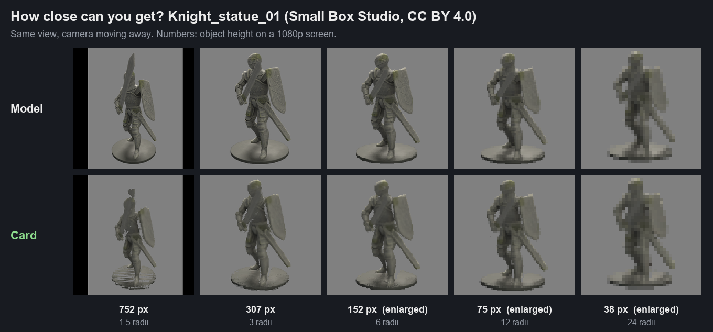
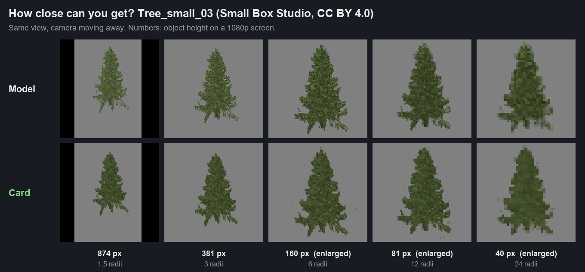
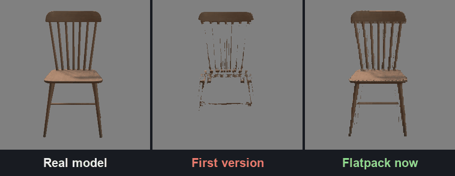
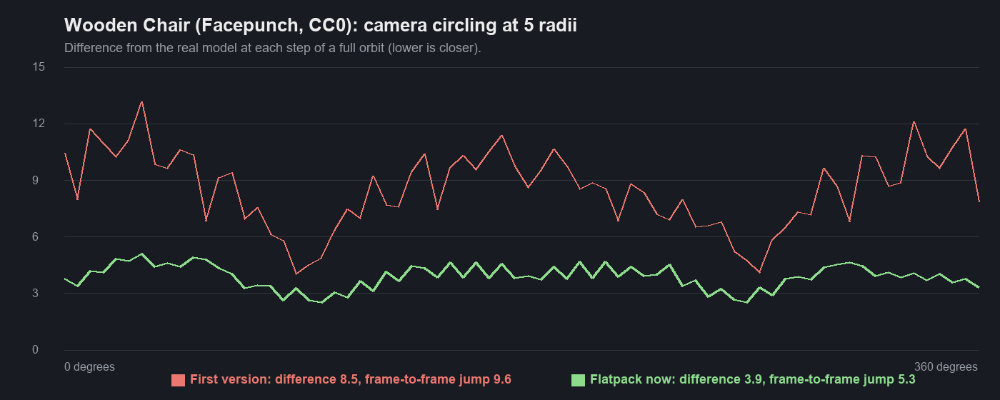
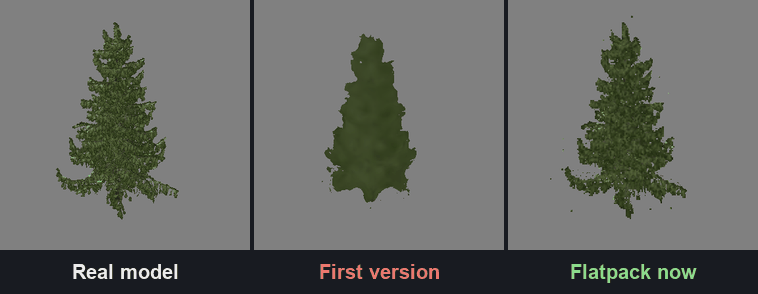
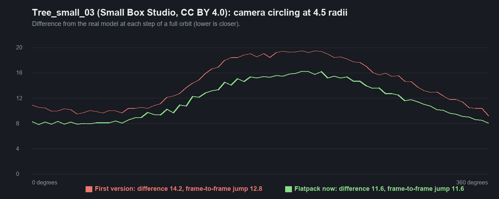
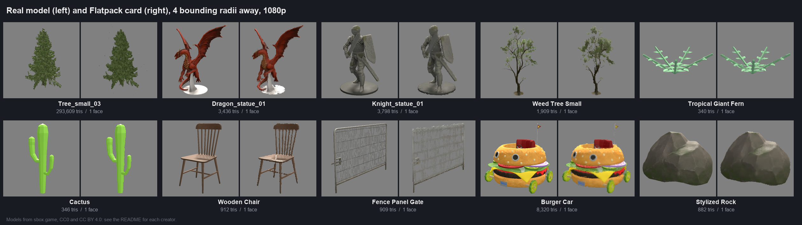

# Iteration 3: ten models, close range and flicker proof

Date: 2026-10-24. Engine 26.10.13b. RTX 3090. Editor, `scenes/flatpack_suite.scene` with ground and sky hidden.

Ten models with public licences from sbox.game, picked to stress different things: dense foliage, sparse twigs,
alpha-cut leaves, thin chair spindles, a fine mesh fence, statues, a vehicle, solid rock. Each baked with the defaults
(12 x 12 hemisphere views, 2048 atlas).

## How it was measured

For each model a harness script, run in the editor, puts the real model and its card on a plain background and
renders them separately (the bakes live in `Assets/flatpack/gallery/`, not in git):

- **Orbit:** the camera circles at 6 bounding radii in 3 degree steps. "Flicker" is the average second
  time-difference per pixel (smooth motion cancels, popping doesn't).
- **Distance ladder:** the same view from 1.5 to 30 bounding radii, 60 degree FOV, rendered at twice 1080p and
  downscaled (a stand-in for anti-aliasing). Score: the share of the object's pixels that differ clearly from the real
  model (more than 25 of 255). The real model is held at its most detailed LOD.

Raw results: `data/eval_round1.jsonl` (before this iteration's fixes) and `data/eval_final.jsonl`.

## How close can you get?

Closest distance from which the card stays under 15% clearly different pixels (checked out to 16 radii), and the
share of different pixels at 2, 4, 8 and 16 radii. Pixel heights are for a 1080p screen at 60 degrees FOV.

| Model | Holds up from | 2 radii | 4 radii | 8 radii | 16 radii | Flicker, card / model |
|---|---|---:|---:|---:|---:|---|
| Stylized Rock | 1.5 radii, 598 px tall | 3% | 1% | 1% | 1% | 4.5 / 4.6 |
| Cactus | 1.5 radii, 760 px tall | 5% | 3% | 1% | 1% | 3.6 / 3.1 |
| Knight_statue_01 | 1.5 radii, 752 px tall | 11% | 6% | 4% | 4% | 5.7 / 5.7 |
| Burger Car | 3 radii, 295 px tall | 18% | 11% | 7% | 4% | 10.7 / 10.3 |
| Dragon_statue_01 | 4 radii, 220 px tall | 24% | 14% | 9% | 10% | 6.1 / 5.8 |
| Tree_small_03 | 6 radii, 160 px tall | 29% | 17% | 10% | 8% | 9.8 / 12.7 |
| Tropical Giant Fern | 6 radii, 68 px tall | 35% | 19% | 13% | 9% | 11.6 / 11.1 |
| Tree_small_01 | 8 radii, 132 px tall | 32% | 20% | 13% | 15% | 12.3 / 17.0 |
| Wooden Chair | 16 radii, 63 px tall | 24% | 18% | 16% | 14% | 11.7 / 11.3 |
| Weed Tree Small | never under 15% | 45% | 36% | 30% | 16% | 7.0 / 6.0 |
| Fence Panel Gate | never under 15% | 23% | 18% | 20% | 47% | 8.9 / 13.2 |

Solid shapes (rock, cactus, statues, the car) hold up almost all the way in. Foliage needs 6 to 8 radii. The default
automatic swap is at 30 radii, which leaves a wide margin; for solid props you can set the Auto Distance Factor much
lower.

## Is the flicker fixed?

The camera circles the object in 5 degree steps. Three versions side by side: the real model, the iteration 1 shader
on its 8 x 8 bake, and the current card.

| Model | Difference from model, first / now | Frame-to-frame jump, first / now |
|---|---|---|
| Wooden Chair | 8.51 / 3.88 | 9.55 / 5.33 |
| Tree_small_03 | 14.24 / 11.63 | 12.83 / 11.62 |

"Frame-to-frame jump" is how much the card's error against the real model changes between steps: a card that tracks
the model has a steady error, one that switches views badly jumps. The tree improves less because foliage is noisy
and the real tree's own aliasing counts into both numbers.

## What changed in this iteration

Round 1 of the ten-model test showed three problems. Fixes, each checked with the same harness:

1. **Card vanished up close.** Below 2 radii the card's plane (the front of the bounding sphere) came nearer than the
   camera's near plane and got clipped: 93 to 95% of pixels wrong on the dragon, rock and car at 1.5 radii. The card
   now backs off toward the centre and is sized to the sphere's exact silhouette. Rock at 1.5 radii: 95% to 5%.
2. **Thin parts broke up at range.** Mipmaps average thin alpha (spindles, twigs) with empty space until it falls
   under the clip. A fixed per-mip alpha boost fixed the chair but filled foliage and the fence into solid blobs, so
   the baker now measures, per mip level, how far coverage drops and writes the exact correction into the material.
   The depth search also reads the mip that matches the pixel's footprint, so small cards stop sparkling.
3. **A fallback for missed thin parts made things worse.** Sampling the centre plane when the depth search misses
   kept a few twigs on the weed tree but raised errors on every other model (chair at 6 radii: 16% to 27%). It stays
   as a material option, off by default.

The harness also had to pin the real model to its top LOD: the trees' own LODs (down to a billboard) made the cards
look worse than they are past 12 radii in round 1.

## Still not good

- **Fence Panel Gate:** a fine wire mesh fills in to a solid grey panel past 12 radii. The real model aliases into a
  sparse grid without anti-aliasing; with MSAA it would read as a faint see-through panel. Neither matches a card that
  clips alpha. Keep fences as real models for now.
- **Weed Tree Small:** its twigs are thinner than one texel at 2048 and its leaves glow with the foliage shader's
  translucency, which the card can't reproduce. Fine from about 16 radii.
- **Wooden Chair:** spindles stay a little thinner on the card than on the model.
- **Dragon base:** the metal base bakes as plain bright colour and reads lighter than on the model.

## Models

| Model | Creator | Licence |
|---|---|---|
| [Tree_small_03](https://sbox.game/smallboxstudio/treesmall03) | Small Box Studio | CC BY 4.0 |
| [Tree_small_01](https://sbox.game/smallboxstudio/treesmall01) | Small Box Studio | CC BY 4.0 |
| [Dragon_statue_01](https://sbox.game/smallboxstudio/dragonstatue01) | Small Box Studio | CC BY 4.0 |
| [Knight_statue_01](https://sbox.game/smallboxstudio/knightstatue01) | Small Box Studio | CC BY 4.0 |
| [Burger Car](https://sbox.game/smallboxstudio/boblepongekrustykrabcar) | Small Box Studio | CC BY 4.0 |
| [Tropical Giant Fern](https://sbox.game/minibox/mw_decorations_biomes_tropical_giant_fern_0) | MiniBox Studio | CC BY 4.0 |
| [Weed Tree Small](https://sbox.game/facepunch/weed_tree_small) | Facepunch | CC0 |
| [Wooden Chair 1](https://sbox.game/facepunch/wooden_chair_a) | Facepunch | CC0 |
| [Fence Panel Gate](https://sbox.game/facepunch/fence_panel_gate) | Facepunch | CC0 |
| [Cactus](https://sbox.game/ambi/cactus) | Ambi | CC0 |
| [Stylized Rock](https://sbox.game/jammie/ghibli_rock) | Jammie | CC0 |

