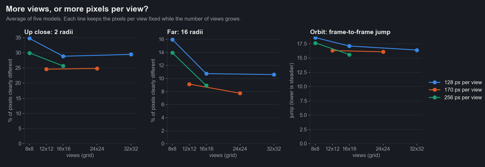
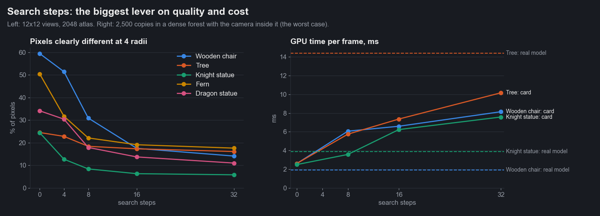
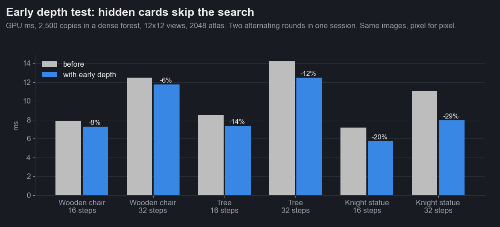
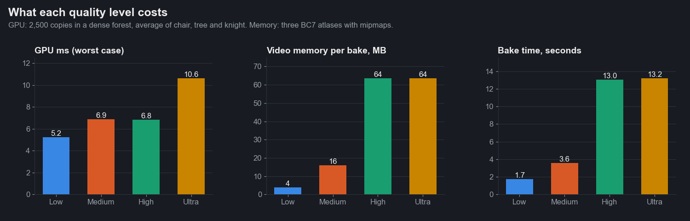
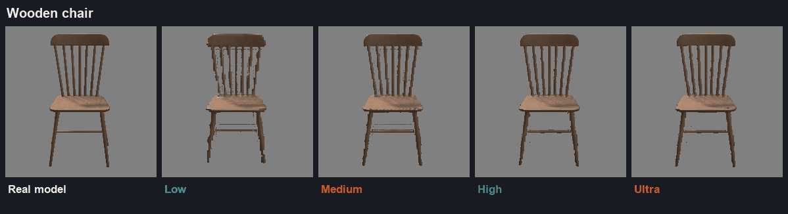
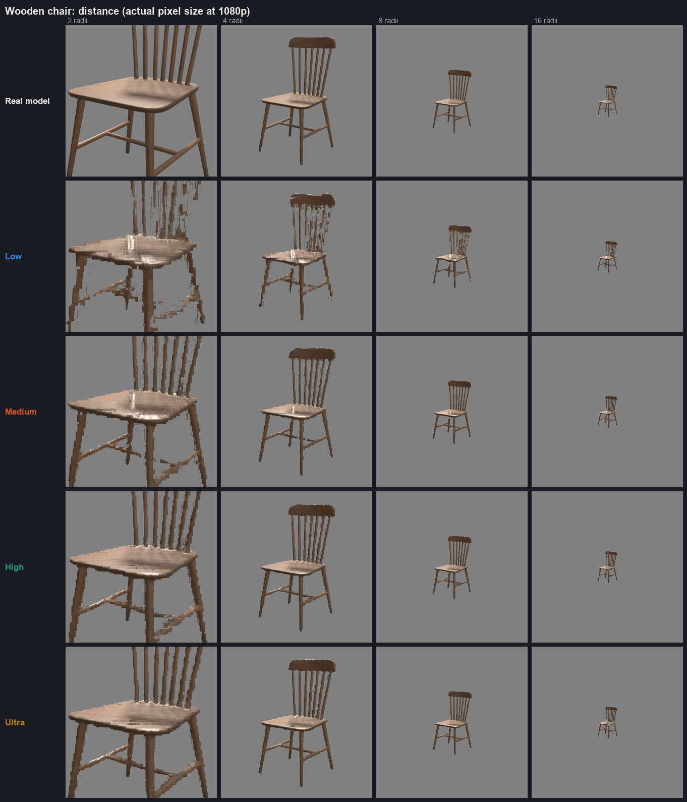
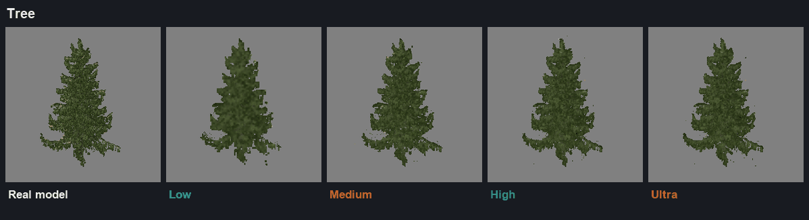
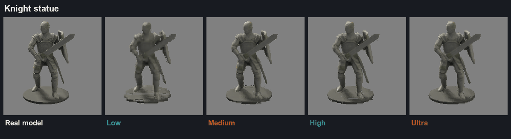

# Iteration 4: quality levels

Date: 2026-10-24. Engine 26.10.13b. RTX 3090. Editor, `scenes/flatpack_suite.scene` (image tests, ground and sky
hidden) and `scenes/flatpack_benchmark.scene` in play mode (GPU tests).

The question: can more views ("more planes") make Flatpack flicker less, and what should the quality levels be? We
baked five models at eight view and atlas combinations, tried every depth search setting, and measured image quality,
flicker, GPU time, memory and bake time for each. The answers became four quality levels in the baker (**Low**,
**Medium**, **High**, **Ultra**) and one shader change that makes every card cheaper.

Models: Wooden Chair (thin spindles), Tree_small_03 (foliage), Knight_statue_01 (solid), Tropical Giant Fern
(alpha-cut leaves), Dragon_statue_01 (detailed, partly metal). Credits at the bottom.

## How it was measured

Same harness as [iteration 3](../iteration-3-ten-models/README.md#how-it-was-measured), plus two new tests:

- **Orbit** (6 radii, 3 degree steps): *flicker* is the average second time-difference per pixel; *jump* is how much
  the card's error against the real model changes from step to step (a card that switches views badly jumps).
- **Distance ladder** (1.5 to 30 bounding radii): share of the object's pixels that differ clearly from the real
  model (more than 25 of 255), rendered at twice 1080p and downscaled.
- **Walk-in** (new): 120 frames from 32 to 2 radii with a slow turn. Catches popping as the card gets bigger on
  screen, which an orbit at a fixed distance can't.
- **Dense forest GPU test** (new): 2,500 copies forced to show the card, camera standing inside the forest so cards
  overlap many layers deep. This is the worst case for a card; GPU time is the median of six one-second samples.

Absolute numbers drift a little between editor sessions (reopening a scene changes them by a point or two), so every
comparison below ran inside one batch. Raw results are in `data/`.

## Do more views reduce flicker?

No. Flatpack's card already flickers as much as the real model does, and no more.

Across all levels and models, card flicker while orbiting is 0.96 to 1.00 times the real model's own. Walking in, the
card flickers *less* than the real model: 0.73 to 0.90 times as much, because the model's thin geometry aliases and
the card's mipmapped atlas doesn't. The flicker you still see comes from the real model's own detail, not from views
switching.

## More views, or more pixels per view?

- **8 x 8 views is too few.** Neighbouring views are about 22 degrees apart and the card ghosts: 35% (1024 atlas) or
  30% (2048) of pixels clearly wrong at 2 radii, against 25% for 12 x 12.
- **Past 12 x 12, more views help at range only.** At the same pixels per view, going from 12 x 12 to 24 x 24 takes
  16 radii from 9.1% to 7.7%; up close nothing changes.
- **Pixels per view decide sharpness up close.** At 16 x 16, going from 128 to 256 pixels per view takes 2 radii from
  28.8% to 25.6%. 16 x 16 at 2048 (128 pixels) is worse than the 12 x 12 default (170 pixels).
- **12 x 12 at 4096 (341 pixels per view)** was the sharpest up close, but worse than the default past 12 radii on four
  of five models (chair at 16 radii: 30.5% against 14.5%). We didn't pin down why, so no level uses it
  (`data/twelve_views_4096.jsonl`).

So the default stays at 12 x 12 views and 2048. High doubles both views and resolution together (24 x 24 at 4096).

## Search steps: the biggest lever

The depth search finds where your view ray hits the baked surface in each view. More steps find thin parts and
lose fewer pixels at silhouettes, and cost GPU time almost in proportion.

- 0 or 4 steps ghosts badly: 30 to 60% of pixels clearly wrong at 4 radii on the chair, fern and dragon.
- 8 steps is fine for solid shapes (knight 8%) but loses thin parts (chair 31%).
- 16 steps (the default) brings the chair to 18%.
- 32 steps helps thin parts up close: the chair at 2 radii goes from 24% to 18%, the dragon from 24% to 19%.

Two other dials tested and left alone:

- **Blend sharpness** above 1 made every model worse (more jump between views), so it stays at 1.
- **A higher minimum step count at range** (the search drops to as few as 4 steps on small cards) changed nothing
  measurable at 8 to 30 radii, so the shader keeps 4 (`data/min_steps.jsonl`).

## Early depth test: hidden cards skip the search

The dense forest test showed what makes cards expensive: every overlapping card ran its full depth search, even for
pixels already hidden behind a nearer card. A shader that writes its own depth turns off the GPU's early depth test.

The fix: the shader now promises that the depth it writes is never nearer than the card itself (`SV_DepthLessEqual`;
the traced surface always lies behind the card). With that promise the GPU tests depth before running the shader and
skips hidden pixels. Images are unchanged, pixel for pixel, on every ladder rung.

Two alternating rounds in one session: 6 to 29% less GPU time in every case. Solid shapes gain most, since they hide
more of what's behind them.

This test also shows when a card is the wrong choice. With the camera standing inside a forest of cards, a simple
model like the wooden chair (632 triangles) costs 1.9 ms as real geometry and 7.3 ms as cards. Cards win at a
distance, where each one covers few pixels: that's what the swap distance is for, and why the scene optimiser marks
cheap models as low gain.

## The quality levels

| Level | Views | Atlas | Search steps | Video memory | Bake time | GPU, worst case |
|---|---|---|---|---|---|---|
| Low | 12 x 12 | 1024 | 8 | 4 MB | 1.7 s | 5.2 ms |
| **Medium** (default) | 12 x 12 | 2048 | 16 | 16 MB | 3.6 s | 6.9 ms |
| High | 24 x 24 | 4096 | 16 | 64 MB | 13.0 s | 6.8 ms |
| Ultra | 24 x 24 | 4096 | 32 | 64 MB | 13.2 s | 10.6 ms |

Video memory is three BC7 atlases with mipmaps. GPU time is the dense forest test, averaged over the chair, tree and
knight.

How close each model holds up (under 15% of pixels clearly different from there out to 16 radii):

| Model | Low | Medium | High | Ultra |
|---|---|---|---|---|
| Knight statue | 3 radii | 1.5 | 1.5 | 1.5 |
| Dragon statue | 16 | 4 | 4 | 3 |
| Tree | 12 | 6 | 6 | 6 |
| Fern | past 16 | 6 | 8 | 8 |
| Wooden chair | past 16 | 16 | 6 | 3 |

Averaged over the five models, Medium and High match up close; High is closer to the real model past 8 radii (8.7%
against 10.4%) and at 30 radii (9.9% against 13.4%). Ultra is the only level that changes the close range: 26% at 1.5
radii against 30%, and the chair holds from 3 radii instead of 16.

More distance strips: [tree](media/presets_distance_tree.png), [knight](media/presets_distance_knight.png).

## What changed

1. **Quality levels** in the bake settings, used by every way of baking (bake window, scene optimiser, right-click
   menus, inspector button). The scene optimiser has its own Quality picker. Pick Custom to set
   views, atlas size and search steps by hand. The baker now writes the search steps into the material.
2. **Early depth test** in the impostor shader: 6 to 29% less GPU time where cards overlap.
3. **Grid size** can go to 32 x 32 in Custom (it stopped at 16).

## Still not good

- **Close-range streaks on flat, tilted surfaces.** The chair seat at 2 radii shows stair-step streaks at every level
  (see the distance strip). The depth search lands on neighbouring texels of a surface seen at a grazing angle.
- **The chair and fern at Low** never get under 15% inside 16 radii. Low is for things you only see far away.
- **Cards cost more than cheap models up close.** Keep the swap distance generous for simple props, or leave them
  as models.

## Models

| Model | Creator | Licence |
|---|---|---|
| [Wooden Chair 1](https://sbox.game/facepunch/wooden_chair_a) | Facepunch | CC0 |
| [Tree_small_03](https://sbox.game/smallboxstudio/treesmall03) | Small Box Studio | CC BY 4.0 |
| [Knight_statue_01](https://sbox.game/smallboxstudio/knightstatue01) | Small Box Studio | CC BY 4.0 |
| [Tropical Giant Fern](https://sbox.game/minibox/mw_decorations_biomes_tropical_giant_fern_0) | MiniBox Studio | CC BY 4.0 |
| [Dragon_statue_01](https://sbox.game/smallboxstudio/dragonstatue01) | Small Box Studio | CC BY 4.0 |
