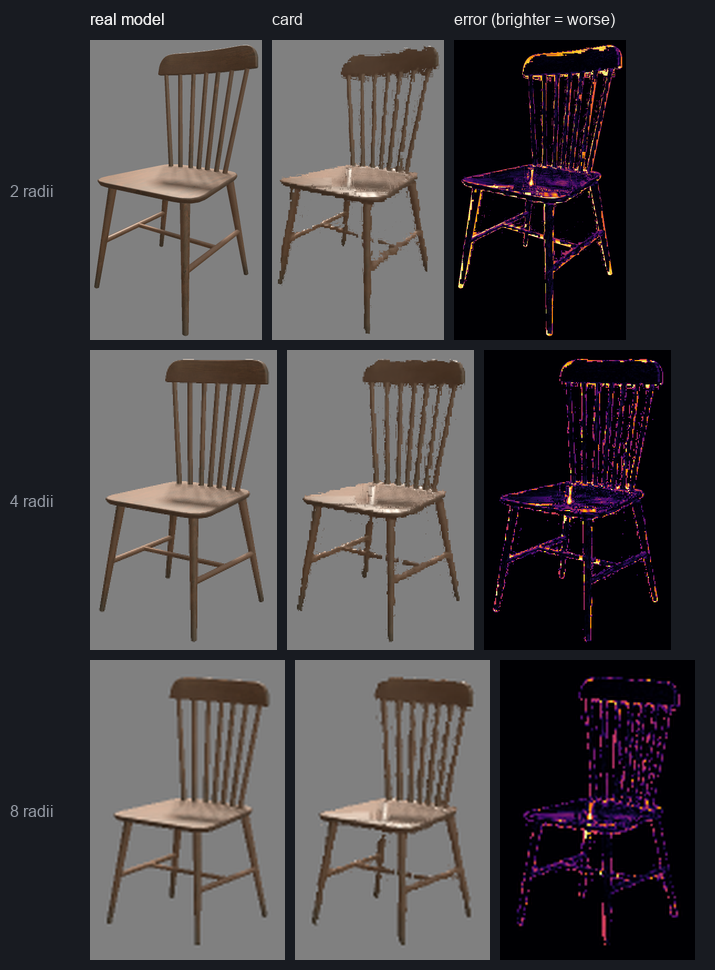
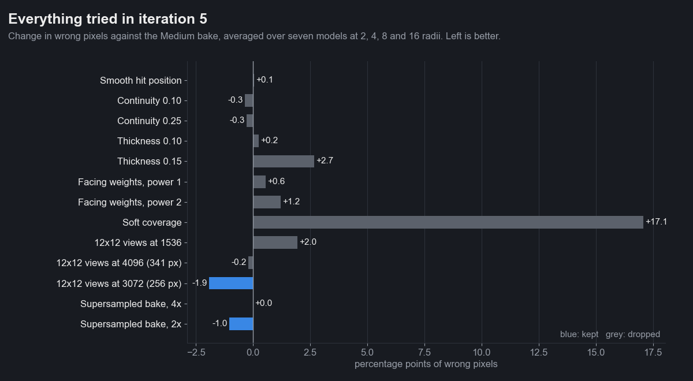
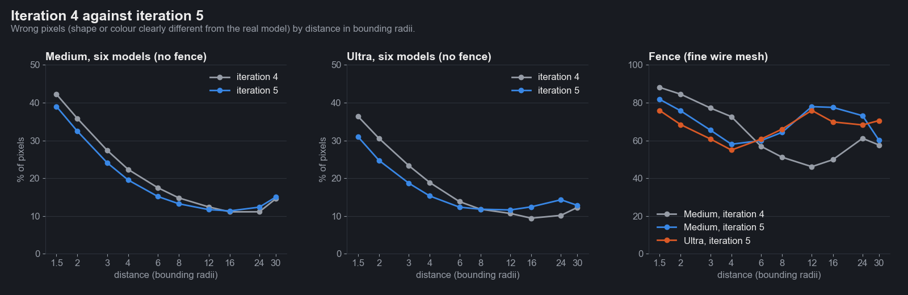
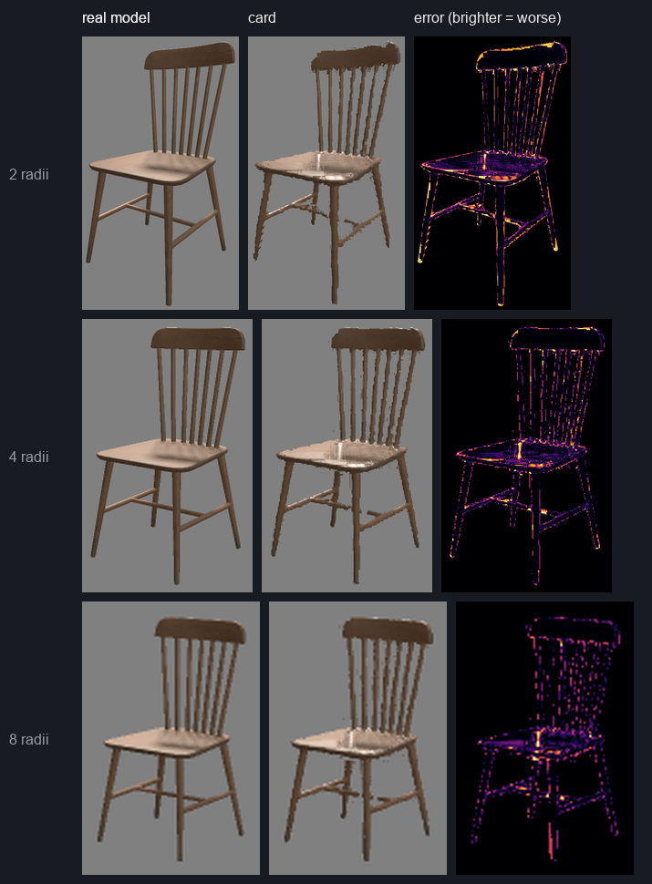
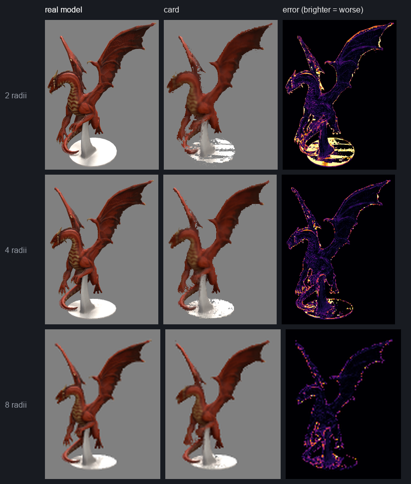
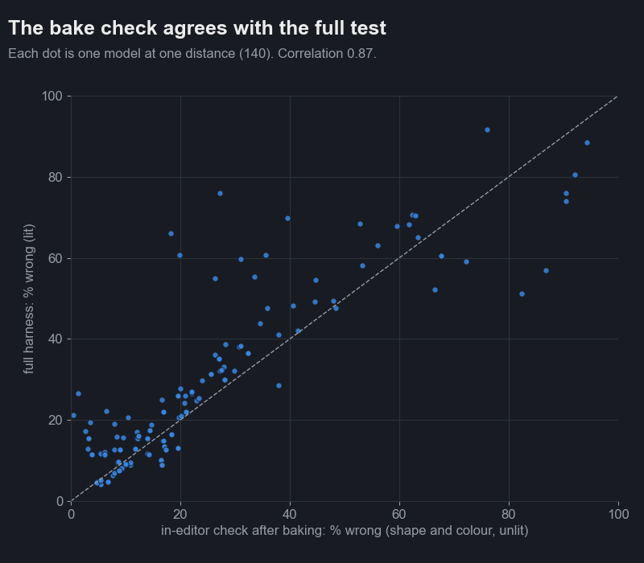

# Iteration 5: measuring better, supersampled bakes, Auto quality

Date: 2026-10-24. Engine 26.10.13b. RTX 3090. Editor, `scenes/flatpack_suite.scene` (image tests, ground and sky
hidden) and `scenes/flatpack_benchmark.scene` in play mode (GPU tests).

Iteration 4 showed what the quality levels trade. This one changes how we look for improvements, then uses that to
find two that hold up, drop seven that don't, and let the baker pick a level for each model by itself.

## A better way to find what's wrong

Three changes to the test harness, so every idea gets judged the same way:

1. **Error heatmaps.** Model, card and a per-pixel difference image at 2, 4 and 8 radii, so failures show up *on the
   object* instead of as one number.
2. **A shape score.** Iteration 4 counted pixels whose colour differs by more than 25 of 255. A light fence filled in
   over a grey background barely changes colour, so a solid panel where the model is see-through scored as fine. The
   new *wrong pixels* score also counts coverage that differs, blurred over 3 x 3 pixels so a wire drawn one pixel over
   isn't punished, but a missing part or a filled-in mesh is. SSIM (structural similarity) is recorded alongside.
3. **A fixed test set, one model per failure type:** Wooden Chair (thin spindles, flat seat), Weed Tree Small (twigs),
   Fence Panel Gate (fine wire mesh), Dragon_statue_01 (metal plinth seen edge-on), Tree_small_03 (foliage),
   Knight_statue_01 (solid control), Tropical Giant Fern (alpha-cut leaves). Every change runs against all seven, so
   fixing one kind of model can't quietly break another.

Every comparison below ran inside one batch, against that batch's own Medium bake.

The heatmaps put most of the error in two places: **flat surfaces seen at a low angle** (the chair seat and the
dragon's plinth show stair steps and holes) and **thin edges** (spindles, wings).

## What we tried

Change in wrong pixels against Medium, averaged over the seven models at 2, 4, 8 and 16 radii. Left is better.

| Idea | Why it looked promising | Result |
|---|---|---|
| Smooth hit position (filtered depth for the final step) | Stair steps come from point-sampled depth | No change. Dropped. |
| Continuity: accept a hit where the ray crosses a smooth surface | Holes on surfaces seen edge-on | Fills part of the dragon's plinth (dragon 15.4 to 14.1%, knight 8.7 to 6.7%) but costs twigs. Kept as a material dial, off by default. |
| Thicker search shell | Same holes | 0.03 and 0.06 are identical (a one-step floor wins); 0.10 and up get worse. Dropped. |
| Facing weights: trust views that saw a surface face-on | Edge-on views store a surface in a few stretched texels | Worse on every model, more so at higher power. Dropped. |
| Soft coverage: alpha straight to alpha-to-coverage once texels are smaller than pixels | See-through mesh at range | 17 points worse. The test renders have no MSAA to resolve it, so it can't be judged fairly; not shipped. |
| 12 x 12 views at 1536 (128 px per view) | Power-of-two views | Too blurry. Dropped. |
| 12 x 12 views at 4096 (341 px per view) | Sharpest up close | Best up close, much worse past 12 radii. |
| **12 x 12 views at 3072 (256 px per view)** | Iteration 4 suspected 341-pixel views lose at range because they don't halve cleanly into mipmaps | Confirmed: 256-pixel views keep the close-range gain without the far loss. **Now Ultra.** |
| **Supersampled bake, 2x** | Thin parts and mesh texture average to solid or to nothing at bake resolution | 1 point better overall, about 3 points up close (fence apart). **Now on by default.** |
| Supersampled bake, 4x | More of the same | No better than 2x, twice the bake time. |

## Iteration 4 against iteration 5

| Six models (fence apart) | 1.5 radii | 2 | 4 | 8 | 16 | 30 |
|---|---|---|---|---|---|---|
| Medium, iteration 4 | 42.2% | 35.8% | 22.3% | 14.8% | 11.1% | 14.5% |
| **Medium, iteration 5** (2x supersampled) | **39.0%** | **32.4%** | **19.5%** | **13.2%** | 11.3% | 15.0% |
| Ultra, iteration 4 (24 x 24 views at 4080, 64 MB) | 36.4% | 30.5% | 18.8% | 11.8% | 9.4% | 12.2% |
| **Ultra, iteration 5** (12 x 12 at 3072, 36 MB) | **31.0%** | **24.7%** | **15.3%** | 11.8% | 12.4% | 12.8% |

- Medium is better up to 8 radii and level beyond. While circling, its card now flickers 0.88 times as much as the
  real model (iteration 4: 0.96).
- Ultra is sharper up close and uses about half the memory. It's worse at 16 radii: Ultra is meant for props that
  swap near the camera, and past 8 radii it now matches Medium.
- Bake time: Medium 3.6 s to about 4.8 s; Ultra about 10 s (was 13).
- GPU cost: the same within noise, measured in one session (Ultra 22.1 against 22.6 ms in the dense forest test, Medium
  14.3 against 14.7 ms). These absolute numbers are about twice iteration 4's: the editor was vsync-locked this time
  and the GPU ran at lower clocks, so only compare GPU numbers inside one batch.

## The baker now checks its own work

After every bake, Flatpack renders the model and the card side by side in a private scene, from four sides at ten
distances, and counts wrong pixels with the same shape-and-colour rule as the harness (unlit, so it measures what a
quality level can change). It takes about 2 seconds. The bake stores the result:

- **Holds up from**: the nearest distance from which at most 15% of pixels are wrong, out to 16 radii. The Flatpack
  Renderer's automatic swap distance never goes closer than this, and the inspector shows it next to the swap distance.
  (Iteration 6 found this too generous by eye and replaced it with a calibrated rule that also measures blur.)

Across 140 model-and-distance pairs the check and the full lit harness agree with a correlation of 0.87. They
disagree mostly far away, where the harness also counts lighting differences (metal, translucent leaves) that no
quality level fixes.

## Auto quality

New quality level **Auto**: bake at Low, check, and step up a level until the card holds up from the target distance
outward (default 30 radii, the automatic swap distance). If nothing holds up, it keeps the level that came closest.

| Model | Target 30 radii | Target 8 radii |
|---|---|---|
| Knight statue | Low (4.3 s) | Low |
| Dragon statue | Low | Low |
| Tree | Low | Low |
| Wooden chair | Low | Medium (11 s) |
| Weed tree | Low | High (62 s) |
| Fern | High (59 s) | High |
| Fence | nothing holds up; keeps Low (45 s) | nothing holds up; keeps Ultra |

At the default swap distance most models need only Low: 4 MB instead of 16. Models that need more pay for it in bake
time, since every level below the one picked gets baked and checked first.

## Still not good

- **Fine wire mesh.** Fences fill in solid, and supersampling made them worse at range, likely because the mesh now
  bakes as partial coverage that the alpha test then turns solid. Keep fences as real models; Auto reports that nothing holds up.
- **Flat surfaces seen edge-on.** Continuity fills some of the holes; the stair steps remain.
- **Lighting differences** (metal, translucent foliage) are the next iteration's work: the check can't see them because
  it measures shape, and the levels can't fix them.

## Models

| Model | Creator | Licence |
|---|---|---|
| [Wooden Chair 1](https://sbox.game/facepunch/wooden_chair_a) | Facepunch | CC0 |
| [Weed Tree Small](https://sbox.game/facepunch/weed_tree_small) | Facepunch | CC0 |
| [Fence Panel Gate](https://sbox.game/facepunch/fence_panel_gate) | Facepunch | CC0 |
| [Dragon_statue_01](https://sbox.game/smallboxstudio/dragonstatue01) | Small Box Studio | CC BY 4.0 |
| [Tree_small_03](https://sbox.game/smallboxstudio/treesmall03) | Small Box Studio | CC BY 4.0 |
| [Knight_statue_01](https://sbox.game/smallboxstudio/knightstatue01) | Small Box Studio | CC BY 4.0 |
| [Tropical Giant Fern](https://sbox.game/minibox/mw_decorations_biomes_tropical_giant_fern_0) | MiniBox Studio | CC BY 4.0 |
