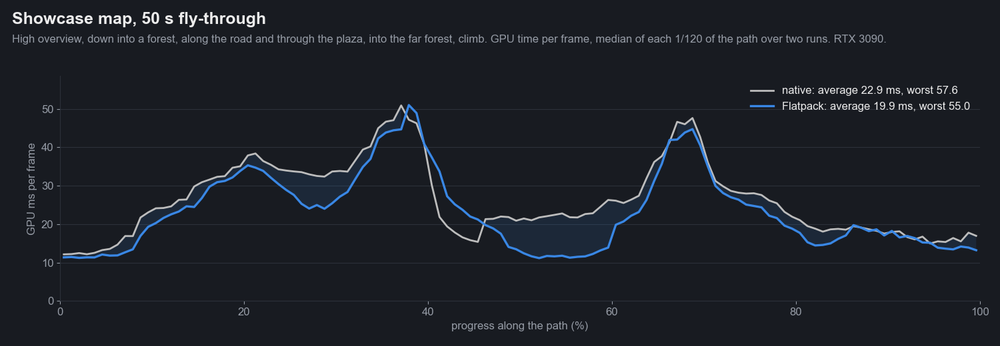
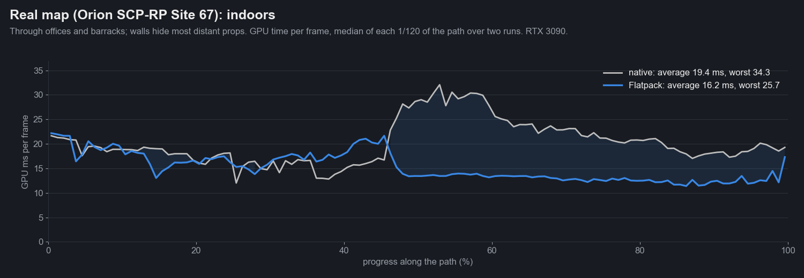
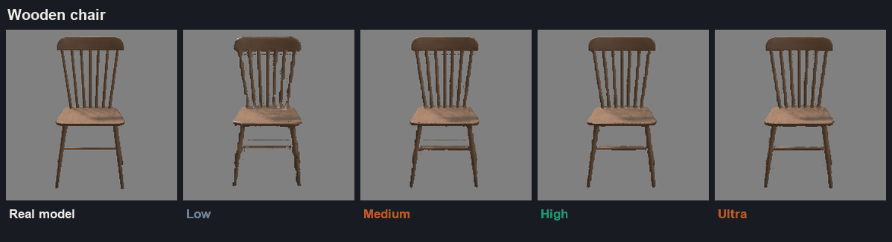

# Iteration 6: real scenes

Date: 2026-10-25. Engine 26.10.13b. RTX 3090.

Iterations 1 to 5 tested one model at a time. This iteration asks the questions a level designer has: where should
the card take over, does it look right to a person (not just to a score), and what does it save on a real map. Four tests:
calibrating the bake check by eye, where to swap, a real game map (Orion SCP-RP's Site 67), and fly-throughs that record
the GPU time of every frame along a camera path, native against Flatpack.

## Does it look right to a person?

Iteration 5's bake check counted clearly wrong pixels and said the knight looked right from 3 bounding radii. Shown
this sheet (real model on the left of each pair, card on the right, at their true size on a 1080p screen), a person
judged:

| Model | Looks right from (by eye) | Iteration 5 check | Calibrated check |
|---|---|---|---|
| Knight statue | 8 radii | 3 | **8** |
| Tree | 6 to 8 radii | 6 | **8** |
| Wooden chair | 6 radii | 6 | **6** |

Counting wrong pixels misses blur: a soft card still has roughly the right colours in roughly the right places. The
check now also measures structural similarity (SSIM), which does see blur, and a card holds up where that difference
is no more than 0.10 above its own floor far away. No fixed cut-off on a single score, and no ratio to the floor,
matched all three judgements; this rule does. On the rest of the test set it gives: dragon 8, fern 6, weed tree 12,
fence never.

## Where should the card take over?

2,500 copies of one model on a field, the camera standing at one edge so near and far copies mix. Native is the real
models everywhere, with the model's own LODs. GPU milliseconds, two rounds averaged:

| Model | Native | Swap at 8 radii | 16 | 30 | 48 |
|---|---|---|---|---|---|
| Tree (534,000 triangles, has its own LODs) | 28.8 | **10.0** | 20.5 | 27.0 | 30.2 |
| Knight statue (3,800 triangles) | 5.7 | 4.0 | 4.0 | **3.5** | 3.7 |
| Wooden chair (912 triangles) | **1.9** | 6.2 | 5.5 | 3.6 | 4.1 |

- **Heavy models: swap as soon as the card looks right.** The tree forest drew in 10 ms swapping at 8 radii against
  29 ms native. At 30 radii almost nothing was saved: the tree's own LODs already simplify the far trees, and the
  cost sits in the trees close to the camera.
- **Light models don't gain.** The 912-triangle chair is cheaper as a real model at every swap distance; a card up
  close covers many pixels and each one runs the depth search. The scene optimiser marks models like this as low gain.
- **Swapping further out (48 radii) gives the tree's gain back** and is no better for the knight.

So the Flatpack Renderer now swaps at the distance where the bake was measured to look right (never closer than 6
radii), instead of a fixed 30 radii. Bakes made before this iteration, which have no measurement, keep 30.

Raw numbers: `data/swap_distance_gpu.jsonl`. GPU times from this session are about twice iteration 4's for the same
work (the editor ran vsync-locked and the GPU at lower clocks), so compare them within this page only.

## A real map: Orion SCP-RP, Site 67

A copy of a real s&box game map, used locally with the owner's permission: an SCP facility with offices, barracks and
labs underground and two forests on the surface. 16,800 objects, 8,661 model renderers (72 million triangles at full
detail), 1,041 map meshes, 1,078 lights. Ten renderers whose model failed to load were switched off before measuring,
in both modes, so the error model couldn't skew anything; no material had a missing texture. The map's images stay
local (most props have no public licence); its numbers are here.

The scene optimiser recommended 59 of its 192 models (2,234 objects, the heavy trees, beds, lights, chairs and panels),
marked 111 as low gain and skipped 24. Applying it took one click after baking (about 6 seconds a model).

**Five viewpoints, four directions each, two rounds** (`data/orion_viewpoints.jsonl`):

| Where | Native GPU | Flatpack GPU | Triangles drawn |
|---|---|---|---|
| Surface, among the trees (2 viewpoints) | 13.1 ms (worst view 20.8) | **9.5 ms (worst 14.6)** | 36 to 42 million to 15 to 27 million |
| Indoors (3 viewpoints) | 13.8 ms | 13.4 ms | 21 to 29 million to 3.6 to 17 million |

Indoors, Flatpack cut the triangles by up to six times and the GPU time barely moved: there the cost is 1,078 lights
and around 3,000 draw calls, not triangles.

## Fly-throughs: every frame along a path

A fixed viewpoint hides the spikes. Here the camera flies a fixed path in real time and every GPU frame time is
recorded, native and Flatpack, two runs each, alternating (`data/flythrough/`). The charts plot the median of each
1/120 of the path.

**Showcase map:** a map built for this from licensed models only (`scenes/flatpack_showcase.scene`): 7,966 objects from
36 sbox.game models, 46 forest clusters with undergrowth, rocks and cacti, a statue plaza and a road lined with cars.
875 million triangles at full detail across the 3,295 objects the optimiser recommended. Along the road Flatpack draws
the frame in about half the time (22 ms to 12 ms). At ground level among the statues (40 to 46% of the path) it's a
little slower: cards close to the camera cost more than these mid-weight statues. The two big peaks, looking across
the whole map from above, are the same either way, so something other than the models sets the cost there.

| Path | Native average | Flatpack average | Native worst | Flatpack worst | Native 95th percentile | Flatpack 95th percentile |
|---|---|---|---|---|---|---|
| Showcase map, 50 s | 22.9 ms | **19.9 ms** | 57.6 ms | 55.0 ms | 39.3 ms | 36.3 ms |
| Orion surface, 30 s | 30.3 ms | **22.5 ms** | 55.2 ms | **47.0 ms** | 45.0 ms | **36.5 ms** |
| Orion indoors, 30 s | 19.4 ms | **16.2 ms** | 34.3 ms | **25.7 ms** | 29.1 ms | **22.0 ms** |

Moving, the indoor path does gain: the first half is the same either way, and the second half (rooms with long
sightlines, where many props are far away) drops from around 30 ms to 13 ms. GPU times in fly-throughs run higher than
the still viewpoints because the camera keeps moving (streaming, shadow updates).

## Real model up close, card far

Tree_small_01 (572,544 triangles), Medium bake with baked self-shadowing, measured to look right from 6 radii. 2,500
of them, camera at the forest's edge, four runs alternating (`data/hybrid_tree_forest.jsonl`):

| | Runs (GPU ms) | Median | Frame rate if the GPU sets the pace |
|---|---|---|---|
| Real models only | 31.7, 62.5, 59.8, 32.3 | 46.0 ms | about 22 FPS |
| Hybrid (real close, card far) | 17.3, 20.5, 17.2, 17.0 | 17.2 ms | about 58 FPS |

The real-model runs swung between about 32 and 60 ms from one run to the next; the hybrid stayed within a few
milliseconds. 90 million triangles drawn against 8 million.

## Graphics settings

`FlatpackSystem.Level` lets a game tie Flatpack to its graphics presets: Off (real models only), Balanced (the default),
Performance (swap at 0.6 times the distance, from 3 radii) and Maximum (0.35 times, from 1.5 radii). On the 2,500-tree
forest, two rounds (`data/graphics_levels.jsonl`):

| Level | GPU | Cards | Triangles drawn |
|---|---|---|---|
| Off | 31.4 ms | 0 | 73.5 million |
| Balanced | 18.0 ms | 2,492 | 14.8 million |
| Performance | 16.6 ms | 2,497 | 7.3 million |
| Maximum | 15.7 ms | 2,500 | 11,700 |

## Matching brightness

Shown the README's first image, a person noticed the card looked brighter than the real tree, so the comparison read as
contrast rather than quality. Measured over the tree's pixels: real tree 107.7 average brightness, plain card 125.4. The
real tree's leaves shade each other; the card's don't. Baking self-shadowing and setting Sky Occlusion to 1 brought the
card to 109.9, within 2%. The README hero, turntable and marketing images now use that bake. Making self-shadowing the
default for foliage is on the roadmap (it darkened solid statues in iteration 2, so it needs to tell them apart).

## The chair at every level, current bakes

Iteration 4's version of this GIF showed parts of the backrest going see-through. With iteration 5's supersampled bakes,
Medium, High and Ultra keep every spindle; Low still breaks them up. Ultra is the closest; Medium and High lose part of
the rear crossbar.

## Models

| Model | Creator | Licence |
|---|---|---|
| [Tree_small_03](https://sbox.game/smallboxstudio/treesmall03) | Small Box Studio | CC BY 4.0 |
| [Knight_statue_01](https://sbox.game/smallboxstudio/knightstatue01) | Small Box Studio | CC BY 4.0 |
| [Wooden Chair 1](https://sbox.game/facepunch/wooden_chair_a) | Facepunch | CC0 |
