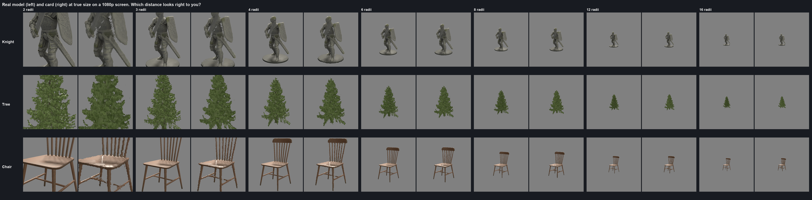

# Iteration 6: real scenes (in progress)

Date: 2026-10-25. Engine 26.10.13b. RTX 3090.

Iterations 1 to 5 tested one model at a time. This iteration asks the questions a level designer has: where should
the card take over, does it look right to a person (not just to a score), and what does it save on a real map. Done
so far: calibrating the bake check by eye, and where to swap. Still to come: a real map (Orion SCP-RP's Site 67) and
a fly-through benchmark over a showcase map, native against Flatpack.

## Does it look right to a person?

Iteration 5's bake check counted clearly wrong pixels and said the knight looked right from 3 bounding radii. Shown
this sheet (real model on the left of each pair, card on the right, at their true size on a 1080p screen), a person
judged:

| Model | Looks right from (by eye) | Iteration 5 check | Calibrated check |
|---|---|---|---|
| Knight statue | 8 radii | 3 | **8** |
| Tree | 6 to 8 radii | 6 | **8** |
| Wooden chair | 6 radii | 6 | **6** |

Counting wrong pixels misses blur: a soft card still has roughly the right colours in roughly the right places. The
check now also measures structural similarity (SSIM), which does see blur, and a card holds up where that difference
is no more than 0.10 above its own floor far away. No fixed cut-off on a single score, and no ratio to the floor,
matched all three judgements; this rule does. On the rest of the test set it gives: dragon 8, fern 6, weed tree 12,
fence never.

## Where should the card take over?

2,500 copies of one model on a field, the camera standing at one edge so near and far copies mix. Native is the real
models everywhere, with the model's own LODs. GPU milliseconds, two rounds averaged:

| Model | Native | Swap at 8 radii | 16 | 30 | 48 |
|---|---|---|---|---|---|
| Tree (534,000 triangles, has its own LODs) | 28.8 | **10.0** | 20.5 | 27.0 | 30.2 |
| Knight statue (3,800 triangles) | 5.7 | 4.0 | 4.0 | **3.5** | 3.7 |
| Wooden chair (912 triangles) | **1.9** | 6.2 | 5.5 | 3.6 | 4.1 |

- **Heavy models: swap as soon as the card looks right.** The tree forest drew in 10 ms swapping at 8 radii against
  29 ms native. At 30 radii almost nothing was saved: the tree's own LODs already simplify the far trees, and the
  cost sits in the trees close to the camera.
- **Light models don't gain.** The 912-triangle chair is cheaper as a real model at every swap distance; a card up
  close covers many pixels and each one runs the depth search. The scene optimiser marks models like this as low gain.
- **Swapping further out (48 radii) gives the tree's gain back** and is no better for the knight.

So the Flatpack Renderer now swaps at the distance where the bake was measured to look right (never closer than 6
radii), instead of a fixed 30 radii. Bakes made before this iteration, which have no measurement, keep 30.

Raw numbers: `data/swap_distance_gpu.jsonl`. GPU times from this session are about twice iteration 4's for the same
work (the editor ran vsync-locked and the GPU at lower clocks), so compare them within this page only.

## Models

| Model | Creator | Licence |
|---|---|---|
| [Tree_small_03](https://sbox.game/smallboxstudio/treesmall03) | Small Box Studio | CC BY 4.0 |
| [Knight_statue_01](https://sbox.game/smallboxstudio/knightstatue01) | Small Box Studio | CC BY 4.0 |
| [Wooden Chair 1](https://sbox.game/facepunch/wooden_chair_a) | Facepunch | CC0 |
