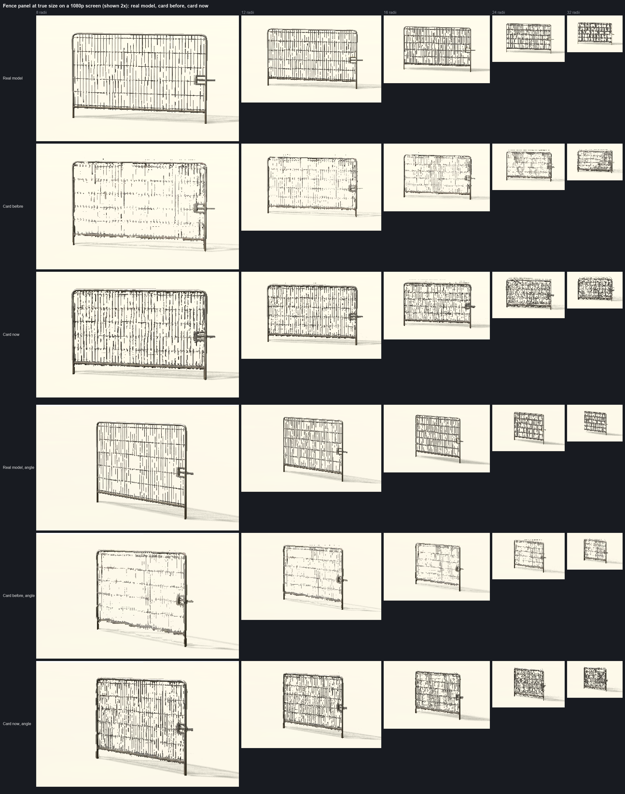
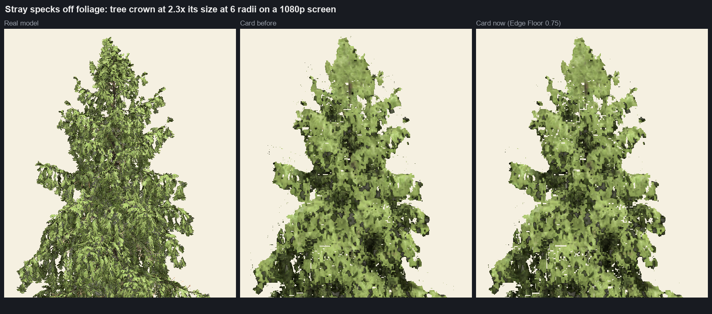
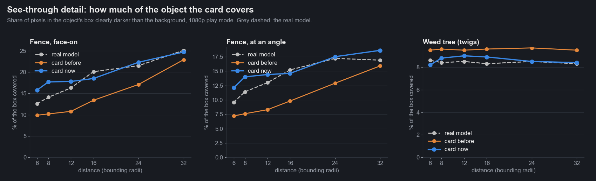

# Iteration 7: see-through detail

Date: 2026-10-25. Engine 26.10.13b. RTX 3090.

Iteration 6's bake check said the fence card never holds up, and README told you to keep fences as real models. This
iteration finds out why the card failed, fixes it, and has the baker spot and tune see-through models on its own. Three
things were wrong: the card dropped most of the wires, it lit the metal fence like painted plastic, and at Medium it
doubled the panel when seen at an angle.

## 1. The card dropped the wires

A fence panel is a grid of wires thinner than one texel of the card's atlas. The bake averages each wire with the gap
beside it, so a wire texel ends up 30 to 60% opaque. The card cuts at 50% and drops most of them: face-on at 12 radii
the old card covered 10.8% of the fence's box where the real fence covers 16.3%.

The real fence goes the other way. Its texture is far finer than the card's atlas, each wire stays at least a pixel
wide, and the panel gets denser as it shrinks: 12.6% covered at 6 radii, 25.1% at 32.

| Try | Result |
|---|---|
| Hand the baked coverage to alpha-to-coverage | No change: the s&box render path runs without MSAA, so the panel drew fully solid |
| Screen-space dither of the baked coverage | Right on average at one distance, flat with distance, and it reads as noise rather than wires |
| Dither that grows with the card's atlas mip | No effect before 32 radii: the card's first mip only starts there |
| Coverage-preserving mips (the engine's `PreserveCoverage`, what the real fence's texture uses) | Wires stay sharp, but coverage stays flat at about 15% and never thickens; also costs a second texture of up to 22 MB, and the engine only builds those mips for power-of-two textures |
| Search depth at full resolution, albedo at full resolution, more search steps, other search thicknesses | No change to the far-distance look |
| **Lower the cut, grow it with screen size** | Wires stay solid lines and thicken with distance like the real ones. Kept |

The kept version multiplies the card's coverage by a strength (Soft Coverage) before the alpha cut, so a 30% wire texel
passes, and by `2^(growth x log2(texels per pixel))` (Soft Growth), so the card thickens as it shrinks on screen. The
depth pass uses the same coverage, so depth and colour agree.

## 2. The fence is metal

With coverage right, the card's wires still came out lighter than the real ones: 140 brightness against 100. Every
material channel matched (albedo 134 on both, roughness 172 against 171, AO and normals equal) except one. The fence's
mesh material is metal, and the card had no metal channel.

s&box has no metalness debug view, and its materials store metalness in different ways (a 4 x 4 constant texture on the
fence mesh; on its frame and on the dragon the metalness feature is on but no texture sits under the usual name), so the baker solves for it instead of
reading it. For each view it renders the Reflect debug view three times under one light: with the real materials, with
copies forced to metalness 0 and with copies forced to metalness 1. Per texel, `metal = (real - dielectric) / (metal - dielectric)`.
Where the two copies reflect alike (dark colours, grazing angles), the texel borrows its neighbours' value.

The result goes in the roughness/AO map's spare alpha channel, as `1 + metal x 254` (alpha 0 would wipe the texel's
colour in the PNG), with a material flag so older bakes keep reading 0. The pass runs only for models with a
metal-capable material.

| Fence at 6 radii, median brightness of the wires | Real model | Card before | Card now |
|---|---|---|---|
| Lit, sun with shadows | 65 | 101 | **63** |
| Lit, sun without shadows | 88 | 132 | **87** |
| Reflect view | 57 | 21 | **55** |

On the test set the solve gives the fence mesh metalness 1, the knight and dragon 0, and skips the chair (no metal-capable
material). Roadmap item 10 (metal parts) is done with this.

## 3. Medium doubles the panel at an angle

At Medium a wire is about one atlas texel wide, and the three views a card blends don't line up on detail that fine. The
panel doubles when you look at it from the side (bottom rows of the sheet above). Ultra has 50% more texels per view
(256 against 170) and lines them up. It also holds up closer: from 6 radii at Ultra against 12 at Medium.

So Auto quality now sends see-through bakes straight to Ultra. Explicit quality choices are left alone.

## 4. Stray specks off foliage

The README hero showed small specks floating off the tree's crown. They came from the card's soft edge. The colour pass
turns coverage into a ramp one pixel wide, `(alpha - Alpha Clip) / fwidth(alpha) + 0.5`, and kept any pixel above
1/255 of it, leaving the rest of the edge to alpha-to-coverage. s&box renders without MSAA, so nothing softens it: a
pixel 40% covered next to an empty one sits on a steep ramp, passes, and is drawn solid. Debug view 3 (new: each frame's
own coverage) showed most speck pixels had no frame above half coverage (427 of 878).

| Cut | Detached pieces on the hero crown | Card against model coverage, test set at 24 radii |
|---|---|---|
| Soft edge, keep above 1/255 (before) | 246 | 1.02 to 1.17 (too dense) |
| Hard cut at Alpha Clip | 61 | 0.67 to 0.96 (thin; weed tree 0.67) |
| **Soft edge, but only pixels at least 0.75 x Alpha Clip** (Edge Floor) | 134, almost none visible by eye | **0.87 to 1.02** |

The real tree has 362 detached pieces of its own at this size (needle tips), so the count can't reach 0. Edge Floor 0.75
removed the visible specks and brought coverage closer to the models at every distance tested: the old edge made far
cards a little too dense (chair 1.17, fern 1.17 at 24 radii). The bake check gives the same distances as before for all
six test models (chair 6, fern 6, knight 8, dragon 8, tree 8, weed tree 12). The hero image is re-rendered with it.

## The baker spots see-through models

Share of covered atlas texels that are only partly covered, measured on the first (Low) bake Auto makes:

| Model | Partly covered |
|---|---|
| Fence panel | 0.69 |
| Weed tree | 0.41 |
| Wooden chair | 0.28 |
| Knight statue | 0.13 |

Above 0.4 the baker marks the bake see-through (`FlatpackImpostor.SeeThrough`) and fits Soft Coverage and Soft Growth by
rendering the model and the card at 8, 16 and 32 radii from two sides at 1080p pixel density, keeping the pair whose
covered pixel count is closest to the model's. The fit renders through the normal lit path: the editor's Albedo debug
view resolves the model's alpha test differently, and a fit done there overfilled the fence in play mode.

Solid models keep Soft Coverage at 0 and draw as before.

## Results

Play mode, 1080p. Share of the object's box covered (clearly darker than the background):

| Fence, face-on | 6 radii | 8 | 12 | 16 | 24 | 32 |
|---|---|---|---|---|---|---|
| Real model | 12.6% | 14.1% | 16.3% | 20.1% | 21.5% | 25.1% |
| Card before | 9.9% | 10.2% | 10.8% | 13.4% | 17.1% | 22.9% |
| **Card now** (Ultra, strength 2.0, growth 0.5) | 15.8% | 17.7% | 17.8% | 18.5% | 22.3% | 24.7% |

| Fence, at an angle | 6 radii | 8 | 12 | 16 | 24 | 32 |
|---|---|---|---|---|---|---|
| Real model | 9.6% | 11.4% | 13.0% | 15.2% | 17.2% | 16.9% |
| Card before | 7.2% | 7.6% | 8.3% | 9.8% | 12.9% | 15.9% |
| **Card now** | 12.1% | 14.0% | 14.4% | 14.6% | 17.5% | 18.6% |

- The fence card now covers within 3.6 points of the real fence at every distance (before: up to 6.7 points short), with
  wires the right shade, and the bake check says it holds up from 6 radii instead of never.
- The weed tree (Auto now bakes it at Ultra too) covers within 0.6 points of the real one at every distance (before:
  up to 1.2 over). The bake check still says 12 radii.

"Card before" is the same fence drawn the way Flatpack drew it before this iteration (Medium, plain alpha cut, no metal).

## It looks right, but it isn't faster

2,500 fences on a field, camera at one edge (iteration 6's field test), GPU milliseconds:

| | GPU ms |
|---|---|
| Real fences everywhere | 14.0 |
| Cards from 8 radii (Ultra) | 17.4 |
| Cards from 8 radii (Medium) | 16.8 |
| Cards from 16 radii (Ultra) | 16.1 |
| Cards from 30 radii (Ultra) | 15.0 |

The fence is 538 triangles, so it's cheap to draw as itself, and a card's per-pixel depth search costs more than that.
Cards from 8 radii also cut the draw calls from about 290 to about 140, which helps where the CPU is the limit, but on
the GPU a light fence is better left as a model. The scene optimiser already marks light models as low gain. A
see-through model with real weight (a detailed chain-link run, scaffolding) is where this pays off.

## What's left

- **Past 24 radii the card speckles** where the real fence shows a tidy grid, and its wires come out a little darker
  (90 against 105). The card rebuilds every pixel on its own from three views; on a grid finer than a pixel, small
  disagreements between neighbouring pixels show as static. Snapping to one view, sharper mips and the engine's
  coverage-preserving mips didn't fix it.
- **A faint dotted line above the top rail** at 24 radii and beyond, when seen from slightly above. Two of the three
  blended views put the rail a few pixels high; with the search off it goes, but the panel then doubles at an angle.
  At true size it's one row of single pixels.
- **Ultra costs 36 MB** per see-through model against 16 MB at Medium.

## Files

- `data/see_through_bench.jsonl`: coverage, darkening and wire brightness per model, view, distance and version.
- `data/fence_field_gpu.jsonl`: the 2,500-fence GPU runs.
- `data/edge_floor_coverage.jsonl`: card against model coverage on the test set for each edge cut.
- `media/fence_before_after.png`, `media/see_through_coverage.png`, `media/specks_before_after.png`.
