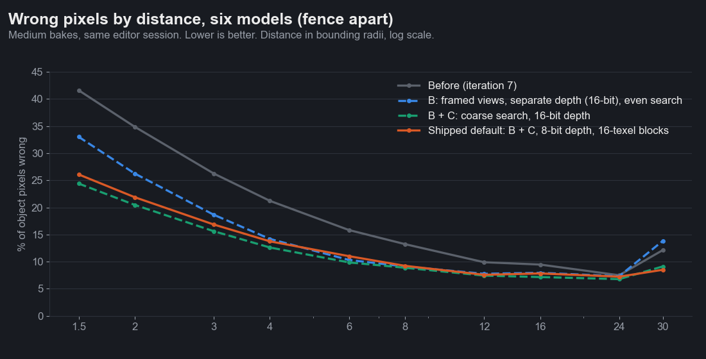
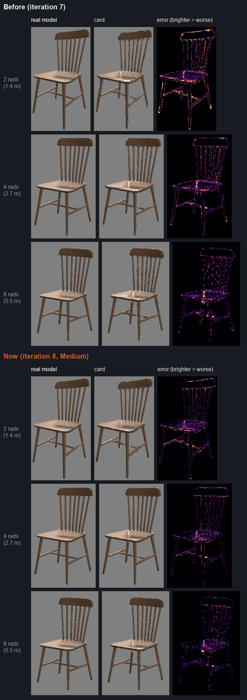
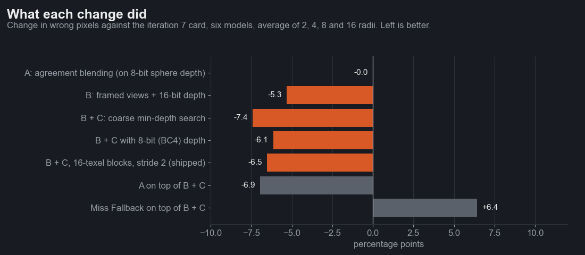

# Iteration 8: making the card look like the model

Date: 2026-10-25. Engine 26.10.13b. RTX 3090. Editor, `scenes/flatpack_suite.scene` (image tests) and
`scenes/flatpack_benchmark.scene` in play mode (GPU tests).

The 2026-10-25 review ([`docs/PLAN-card-look.md`](../../docs/PLAN-card-look.md)) found that the card loses its look to
reconstruction, not resolution: three views averaged without checking they agree, 8-bit depth packed into the normal
atlas, an even-step search that steps over thin parts, and sphere-sized frames that leave half of every view empty. This
iteration works through its plan in order (A, B, C, then a foliage pass and a silhouette pass), measuring each step
before the next.

| Six models (fence apart), Medium | 1.5 radii | 2 | 4 | 8 | 16 | 30 |
|---|---|---|---|---|---|---|
| Iteration 7 | 41.6% | 34.9% | 21.2% | 13.2% | 9.5% | 12.1% |
| **Iteration 8** (framed views, 8-bit depth, coarse search) | **26.1%** | **21.9%** | **13.8%** | **9.2%** | **7.8%** | **8.5%** |

Same harness as iterations 5 to 7 (wrong pixels: shape or colour clearly off), same seven-model test set, every number
from one editor session. While circling the chair at 6 radii the card's jump between steps fell from 11.5 to 9.6, and
the card flickers as much as the real model (2.54 against 2.52), as before.

More heatmaps: [dragon](media/heatmap_dragon_statue.png), [knight](media/heatmap_knight_statue_01.png),
[tree](media/heatmap_tree_small_03.png).

## What we tried

| Step | Result | Kept |
|---|---|---|
| A. Agreement blending | Chair and fern about a point better, knight, dragon, tree and fence 0.3 to 1.5 points worse at 4 to 16 radii. On top of B and C, the same pattern | As a dial, off |
| B. Framed views and a depth texture of their own | 5.3 points better on average; 4 to 12 points at 2 radii | Yes |
| C. Coarse min-depth search | About 2 points more; the knight at 2 radii drops from 12.3% to 5.1% | Yes |
| Miss Fallback with C | 14 points worse on average at 2 radii (chair 9% to 38%); only the weed tree gains | Removed |
| Foliage pass (self shadow on, normal smoothing) | Both trees worse, by up to 35 points | No |
| Silhouette rim pass | Not built: a second trace over every card costs more than twice the plan's 20% limit | No |

### A. Blend by agreement

After the three traces, each view's weight is scaled down when its hit lies more than a set distance (Agreement, in
bounding radii) behind the nearest view's hit, so two surfaces don't show at once. It fades in with the nearest view's
share of the blend, so a view entering the blend can't take over in one step.

| Agreement falloff (Medium, iteration 7 bakes) | 2 radii | 4 | 8 | 16 |
|---|---|---|---|---|
| Off | 34.9% | 21.2% | 13.2% | 9.4% |
| 0.04 radii | 34.8 | 21.4 | 13.3 | 9.6 |
| 0.08 radii | 34.6 | 21.2 | 13.2 | 9.5 |
| 0.15 radii | 34.5 | 21.1 | 13.2 | 9.4 |

Six-model averages: the gains and losses cancel. Per model, the chair and the fern gain about a point at every
distance, the knight, dragon and tree lose up to 1.5 at 16 radii.
Widening the falloff with the mip level (on up close, fading out at range) didn't change that. The doubling the review
saw is real, but it is a small share of the wrong pixels: most of them were holes and streaks from the depth, which A
can't touch. On top of B and C the result was the same (0.5 points worse on average), so Agreement stays a material
dial, off by default. The plan's "done when" (better on the dragon, chair and fence, no model worse) isn't met.

### B. Per-view framing and a real depth channel

- **Framing.** The baker fits each view's orthographic camera to the model's outline in that view (from the vertices),
  padded two texels, with a projection of its own width and height. A tall statue fills its views both ways instead of
  a third of their width. The 12 x 12 lookup texture of rectangles and depth ranges is read once per card corner in the
  vertex shader.
- **Depth.** Depth moves out of the normal atlas's alpha into a texture of its own: BC4 (8 bits, the default) or R16
  (16 bits, Depth Bits 16). It spans one bounding diameter back from the view's nearest surface. Fitting it to the
  object's own depth range instead put the empty background just behind the object, and mips that average an outline
  with it read as real surfaces: the card grew and speckled from about 12 radii. The search marches only the fitted
  range, so its steps are finer.
- **Sampling.** Framing stretches texels: a fern seen from the side gets about three times as many texels down as
  across. One mip level for both directions blurred the long one, and far cards lost 2 to 12 points. Framed bakes now
  sample colour, normal and material through an anisotropic filter with the pixel's footprint.
- **Normals** stay object-space BC7. A two-channel camera-space encoding (BC5, hemi-octahedral) was tried: its mips
  pulled the varied normals of foliage toward the camera and darkened the fern by about 7 levels at range.

| B alone (C off), six models | 1.5 radii | 2 | 4 | 8 | 16 | 30 |
|---|---|---|---|---|---|---|
| Iteration 7 | 41.6% | 34.9% | 21.2% | 13.2% | 9.5% | 12.1% |
| Framed, 16-bit depth | 33.0 | 26.2 | 14.2 | 9.1 | 8.0 | 13.8 |

An earlier batch (before the anisotropic fix and with the BC5 normals below) also baked the depth change without the
framing, six-model average against iteration 7: 3 points better at 2 radii (framed: 7), 2 at 4 (framed: 7), 0.4
better at 16 (framed: 4 worse, the far loss the sampling fix then removed).

The plan's "done when": the chair seat and the dragon plinth lose most of their stair steps at 2 radii (heatmaps above;
a strip at the plinth's far edge remains), and the close-range average improves by more than Ultra's 8 points over
Medium: by 13 points at 2 radii with the shipped default, at about 19 MB against Medium's 17.

### C. Coarse min-depth search

The baker writes a small map of each view's nearest surface per 16 x 16 texel block. The search walks the view block
by block: a block whose nearest surface is still below the ray where the ray leaves it is skipped in one step, and
only blocks the ray can reach are marched at full resolution, every 2 texels. Thin parts are found by construction,
and the shell thickness no longer needs a floor tied to a step size.

| B + C, six models | 1.5 radii | 2 | 4 | 8 | 16 | 30 | Chair jump |
|---|---|---|---|---|---|---|---|
| 8 x 8 blocks, every texel, 16-bit depth | 24.4% | 20.5% | 12.6% | 8.9% | 7.2% | 9.1% | 8.0 |
| 8 x 8 blocks, every texel, 8-bit depth | 27.3 | 22.8 | 14.2 | 9.2 | 8.0 | 9.6 | 8.8 |
| **16 x 16 blocks, every 2 texels, 8-bit** (shipped) | 26.1 | 21.9 | 13.8 | 9.2 | 7.8 | 8.5 | 9.6 |

GPU time, 2,500 cards with the camera inside the field (median of three interleaved rounds). Frame rate is 1000 divided
by the GPU time: what you'd get if the GPU sets the pace.

| Model | Iteration 7 | B alone | B + C, 8 x 8 blocks | B + C, 16 x 16 every 2 texels (shipped) |
|---|---|---|---|---|
| Wooden chair | 35.6 ms (28 FPS) | 31.3 ms (32 FPS) | 39.6 ms (25 FPS) | 37.7 to 40.9 ms (24 to 27 FPS) |
| Tree | 31.0 ms (32 FPS) | 30.0 ms (33 FPS) | 33.2 ms (30 FPS) | 30.7 to 30.8 ms (32 to 33 FPS) |
| Knight | 26.8 ms (37 FPS) | 23.9 ms (42 FPS) | 33.3 ms (30 FPS) | 29.6 to 30.3 ms (33 to 34 FPS) |

GPU numbers drift between rounds by up to 25% in this editor session (vsync, clocks), so only the interleaved rounds
compare. Framing alone is 3 to 12% cheaper than iteration 7 (a narrower march), 3 to 14% more frames per second; the
shipped search costs about the same on the tree and 6 to 15% more on the chair and knight, 6 to 13% fewer frames per
second (the chair 28 FPS to 24 to 27, the knight 37 to 33 to 34). The plan's "done when" for C:

- The chair holds up from 4 radii at Medium (iteration 7: 6 in this session, 16 when the plan was written). Met.
- The weed tree's twigs at 4 radii: the trunk and main branches are whole now, where the old card broke them up; the
  finest twigs, thinner than a texel, are still missing. Partly met.
- Miss Fallback removed: with C it made five of the six models worse (chair 9% to 38% at 2 radii). Met.
- Dense forest no worse than iteration 7's Medium: not met on the chair and knight (6 to 15% more).

### The fence

Fine wire mesh did worse framed: a panel seen edge-on squeezes into a sliver of texels, and its card came out sparser
than the real fence from 16 radii (64 to 68% wrong against 45). Bakes whose covered texels are more than half partly
covered (fence 0.59 framed, weed tree 0.42) now bake again unframed. With that, the fence at Ultra holds up from 6
radii as in iteration 7, is better up close (59% wrong at 2 radii against 63) and a few points worse past 16 radii
(51 to 56% against 45 to 50). Its soft-coverage growth no longer thins it below Soft Coverage up close, which had made
it all but vanish at 2 radii.

### The bake check

The in-editor check (Holds up from) measured right after a bake into a new folder rendered the card before the new
textures were on the GPU: a chair measured 12 radii straight after its first bake and 4 once loaded. It now renders the
card twenty times, a frame apart, before measuring. Holds up from, iteration 7 bakes against iteration 8 (same session):

| Model | Iteration 7 | Iteration 8 |
|---|---|---|
| Wooden chair | 6 | 4 |
| Dragon statue | 8 | 4 to 6 |
| Knight statue | 8 | 6 |
| Tree | 8 | 6 |
| Weed tree | 16 | 12 |
| Fern | 6 | 3 |
| Fence (Ultra) | 6 | 6 |

The rule is relative (each distance against the card's own far-range score), so a card that also got better far away
gains less here than in the harness.

### Foliage pass: tried, not kept

The plan's foliage pass had three parts. Measured on the tree and the weed tree, with lit brightness (card against model,
object pixels) and wrong pixels:

| | Tree, brightness at 6 / 12 radii | Tree, wrong at 2 radii | Weed tree, brightness at 6 / 12 | Weed tree, wrong at 2 |
|---|---|---|---|---|
| Iteration 8 card | +8.7% / +17.6% | 17.3% | -4.1% / -5.0% | 52.7% |
| Self shadow on, Sky Occlusion 1, blurred | -19.2% / -12.5% | 43.7% | -25.5% / -25.5% | 64.3% |
| Normals leaned halfway toward the crown's outside | +12.7% / +22.5% | 33.4% | -15.0% / -16.4% | 56.3% |
| Both | -13.4% / -5.6% | 52.8% | -35.1% / -35.7% | 69.7% |

The self shadow overshoots, and the two trees want opposite amounts (the tree about 0.3, the weed tree 0), so no
default works without hand tuning. Translucency wasn't built: the engine's Transmission debug view is black for
`foliage.shader` (it adds wrap and back-scatter as emission, not as a material channel), and on this test set it would
add light where the tree card is already too bright. The plan's other target, foliage DSSIM at 6 and 12 radii below the
knight's in the bake check, is out of reach for a lighting pass: the check renders unlit, and the tree's 0.25 against
the knight's 0.12 is shape, not light.

### Silhouette rim pass: not built

The rim pass draws every card a second time, translucent, tracing again (4 steps) to find its soft edge. What that
costs, from the forest test: a 4-step trace over every card alone takes 17.7 to 23.1 ms and a pass with no search at all
15.1 to 16.5 ms, against 29.6 to 40.9 ms for the shipped card. That is at least 40% more GPU time (at least 29% fewer
frames per second: even with the cheaper pass added, the knight forest would drop from 34 FPS to 22 and the chair forest
from 24 FPS to 17), twice the plan's 20% limit, and the forest's cards are large on screen, so a screen-size cutoff
wouldn't save it.

## Metres beside radii

Distances shown to people now carry metres too: radii times the bounding radius in world units times 0.0254 (s&box
units are inches), one decimal under 10 m. The same conversion as the iteration 6 tree sheet ("6 radii (21 m)": radius
140.08 units). It lives in `FlatpackMath.FormatMetres`, used by the Flatpack Renderer inspector and the bake check
summary; the harness heatmaps and the iteration 3 and 4 distance sheets use the same rule.

## Files

- `data/a_agreement_sweep*.jsonl`: step A, falloffs and mip widening, on the iteration 7 bakes.
- `data/b_*.jsonl`, `data/c_first_coarse.jsonl`: framing and depth variants, the anisotropic fix, the first coarse search.
- `data/final_batch.jsonl`: the comparison every table above comes from (runs `F_base`, `F_b`, `F_c`, `F_c8`, `F_cA08`,
  `F_cMF`, `Q_c16s*`, the fence `U_*` runs and the foliage `FOL_*` runs).
- `data/gpu_forest_*.jsonl`: dense-forest GPU rounds.
- `data/bake_check_at_bake_time.txt`: Holds up from as each bake reported it.
