# Flatpack

**Impostors for s&box, by Anakin Studio.** Flatpack bakes a high-poly model into a single camera-facing card that
looks like the model from every angle, lights like it, and casts its shadow.

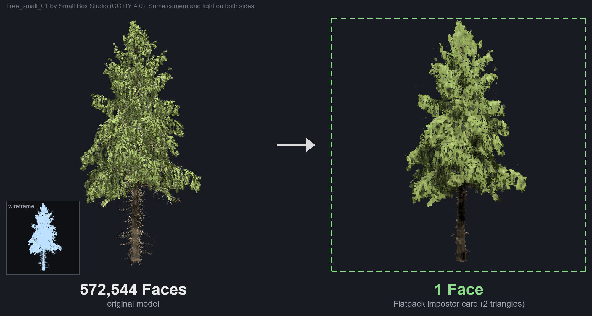

<sub>Same camera and light on both sides. Card: Ultra bake with baked self-shadowing (Sky Occlusion 1), which brings
its brightness within 1% of the real tree.</sub>

## Real model up close, card at a distance

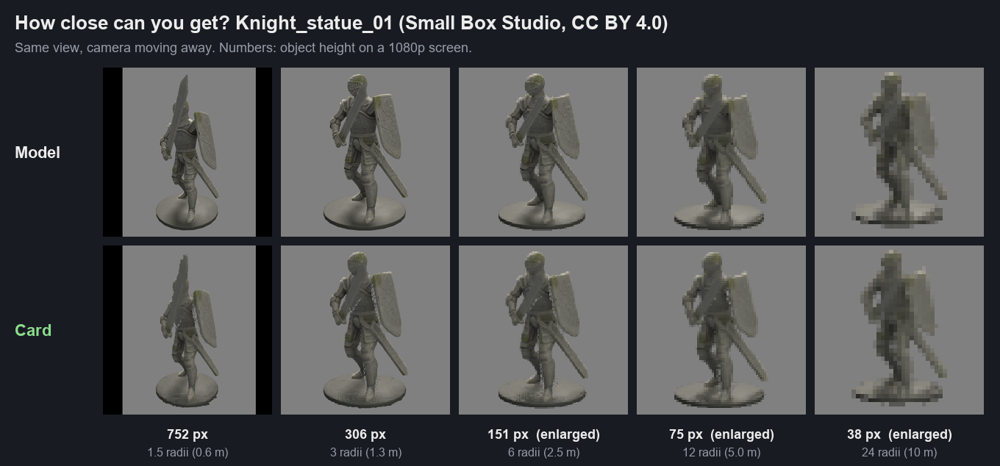

The real model on top, its card below, as the camera moves from 1.5 to 24 bounding radii. The numbers under each
pair are the knight's height on a 1080p screen.

Far from the camera, a 572,544-triangle tree and a 2-triangle card look the same, and the card costs almost nothing to draw.
Flatpack renders the model from 144 directions into texture atlases, then draws one quad that picks the three views
nearest yours, traces into their baked depth so they line up, and blends them as you walk around it.

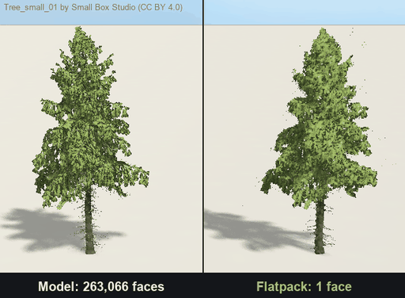

## What it saves

100 hospital beds (974,642 triangles each) on an RTX 3090, everything else in the scene held the same:

| | GPU time | Triangles drawn |
|---|---:|---:|
| Real models | 52.3 ms | 326,505,084 |
| Flatpack cards | 1.6 ms | 706 |

| Model (instances) | GPU ms, model | GPU ms, cards |
|---|---:|---:|
| Hospital bed, 974,642 tris (100) | 52.29 | 1.63 |
| Small tree, 572,544 tris, close (100) | 10.23 | 4.21 |
| Office chair, 15,378 tris (400) | 4.11 | 1.51 |
| SCP-173 statue, 6,630 tris (400) | 3.16 | 1.72 |
| Tall plant, 1,832 tris (400) | 1.75 | 1.70 |
| Small tree, far, own billboard LOD active (100) | 1.25 | 1.88 |

The empty scene costs 1.30 ms. Cards cost about the same whatever they replace, so the saving grows with the source's
triangle count. Below a couple of thousand triangles, or when a model already ends in a cheap billboard LOD, a card
won't beat it. Method and raw numbers: [`Benchmarks/`](Benchmarks/README.md).

## Ten models, side by side

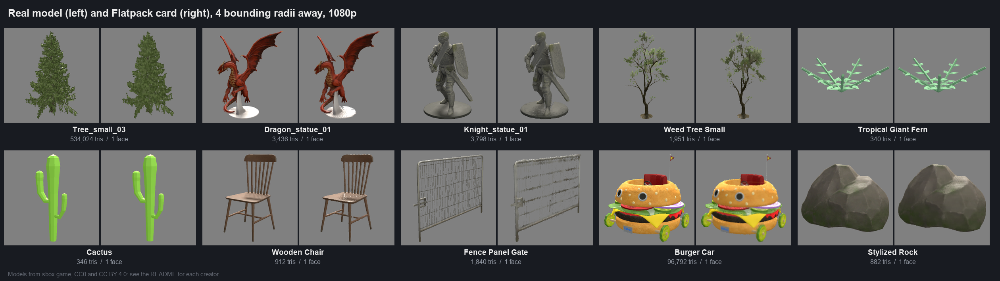

Real model on the left of each pair, the card on the right, at 4 bounding radii on a 1080p screen. All ten are
public models from sbox.game (credits in [iteration 3](Benchmarks/iteration-3-ten-models/README.md#models)).

### Steady while you move

The camera circles a chair: real model, Flatpack's first shader, and the current one.

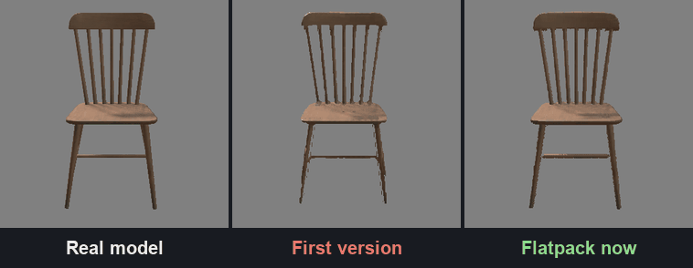
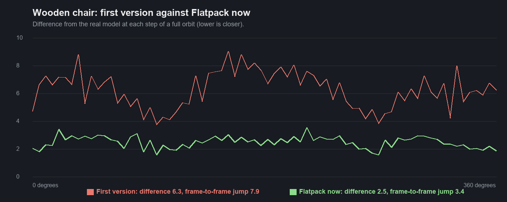

Across the full circle the current card (Medium) stays 2.5 away from the real model on average (the first shader, on
the same bake data: 6.3), and that difference changes less than half as much from one step to the next (3.4 against
7.9), which is what you see as flicker.

### How close can you get?

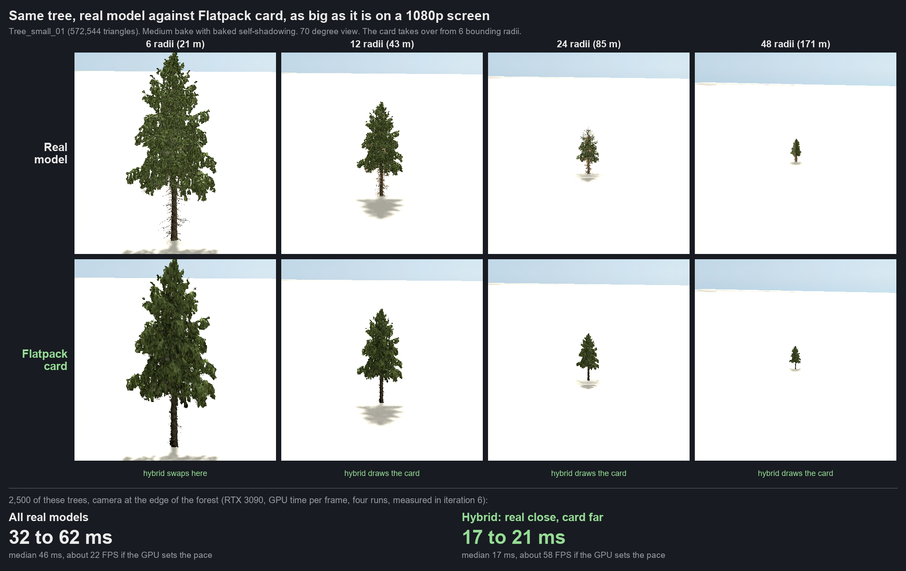

Each tile is the size the tree really is on a 1080p screen. Up close you get your real model; from the distance where
the card looks the same (measured after every bake, 6 bounding radii for this tree), the card takes over. A forest of
2,500 of these trees drew in 17 to 21 ms with the hybrid against 32 to 62 ms as real models only (four runs each on an
RTX 3090; details in [iteration 6](Benchmarks/iteration-6-real-scenes/README.md#real-model-up-close-card-far)).

| Kind of model | Card holds up from | On a 1080p screen | For example |
|---|---|---|---|
| Solid shapes: rocks, cacti, statues | 1.5 to 4 bounding radii | 220 to 760 px tall | knight statue, 0.42 m radius: 0.6 to 1.7 m |
| Vehicles and props | about 3 radii | about 300 px tall | wooden chair, 0.69 m radius: 2.1 m |
| Trees and ferns | 6 to 8 radii | 130 to 160 px tall | Tree_small_03, 3.73 m radius: 22 to 30 m |
| Thin spindles, twigs | about 16 radii | about 60 px tall | weed tree, 1.48 m radius: 24 m |
| Fine wire mesh (fences) | about 6 radii at Ultra (see-through bakes, iteration 7) | about 160 px tall | fence panel, 1.99 m radius: 12 m |

Distances in radii scale with the model; metres are radii times its bounding radius (s&box units are inches). The table
is from iteration 3's harness; iteration 8's framed views and coarse search brought the chair from 6 radii to 4 and the
fern from 6 to 3 by the bake check
([iteration 8](Benchmarks/iteration-8-card-look/README.md)).

The default swap happens at 30 radii, well past all of these. Full per-model numbers:
[`Benchmarks/iteration-3-ten-models`](Benchmarks/iteration-3-ten-models/README.md).

## Quality levels

Pick a level when you bake, or pick **Auto** and let the baker choose. Medium is the default.

| Level | Views | Atlas | Search steps | Video memory | Use it for |
|---|---|---|---|---|---|
| Low | 12 x 12 | 1024 | 8 | 5 MB | Props you only see from far away |
| **Medium** | 12 x 12 | 2048 | 16 | 19 MB | Almost everything |
| High | 24 x 24 | 4096 | 16 | 75 MB | Large props you see from mid range |
| Ultra | 12 x 12 | 3072 | 32 | 42 MB | Thin or detailed props that swap near the camera |
| Auto | picks one | | | | Bakes at Low, checks the card against the model, and steps up until it holds up from your swap distance |

Memory includes the 8-bit depth texture each bake has had since iteration 8; Depth Bits 16 adds about half again
(Medium 27 MB). Ultra and the 32 search steps cost about 1.5 times Medium's GPU time where cards fill the screen; the other levels cost
about the same as Medium. Every bake is supersampled 2x (thin parts bake as partial coverage) and checked against the
model afterwards: the bake stores the distance from which the card looks like the model, and the Flatpack Renderer
swaps there. The check was calibrated against a person's judgement
([iteration 6](Benchmarks/iteration-6-real-scenes/README.md#does-it-look-right-to-a-person)).

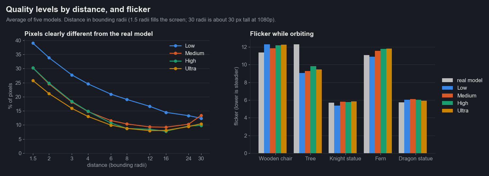
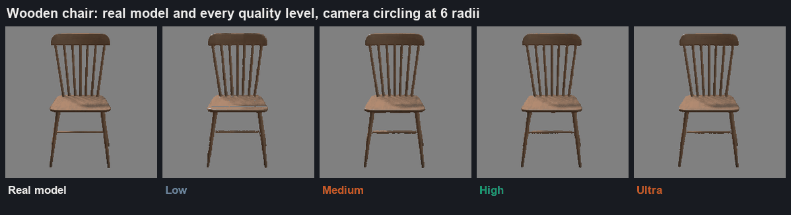

More views don't reduce flicker: at every level the card flickers as much as the real model does, and no more. What
changes is sharpness. Ultra's extra search steps keep thin parts up close (the chair holds up from 3 radii at Ultra
and 4 at Medium), and High's extra views and pixels help past 8 radii. Measurements, charts and the GPU tests behind the table:
[`Benchmarks/iteration-4-quality-levels`](Benchmarks/iteration-4-quality-levels/README.md), and for supersampling, the
new Ultra, the bake check and Auto: [`Benchmarks/iteration-5-measure-and-auto`](Benchmarks/iteration-5-measure-and-auto/README.md).

In iteration 5's test at a 30-radii target, Auto picked Low for most models (4 MB instead of 16): the knight, dragon,
tree and chair. It stepped up only where it had to, like the fern (High).

## Where to swap

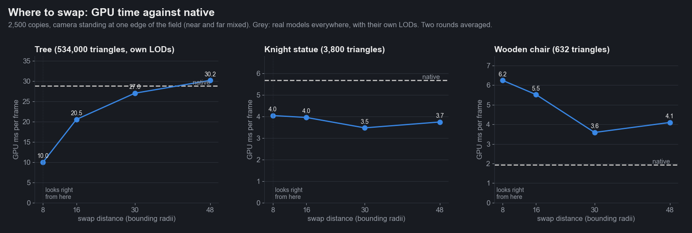

2,500 copies of one model, the camera at the edge of the field so near and far copies mix. Grey is native: real models
everywhere, with their own LODs.

| Model | Native | Flatpack, best swap | Swap at |
|---|---|---|---|
| Tree (534,000 triangles) | 28.8 ms | **10.0 ms** | 8 radii (28 m), where the card starts to look right |
| Knight statue (3,800 triangles) | 5.7 ms | **3.5 ms** | 30 radii (13 m) |
| Wooden chair (912 triangles) | **1.9 ms** | 3.6 ms | (cheaper as a real model) |

Heavy models gain the most, and only if the card takes over as soon as it looks right: at 30 radii the tree forest
saved almost nothing, because its own LODs already simplify the far trees. Very light models are cheaper as real
models. So the Flatpack Renderer swaps at the bake's measured distance by default, and the scene optimiser marks light
models as low gain. Details: [`Benchmarks/iteration-6-real-scenes`](Benchmarks/iteration-6-real-scenes/README.md).

## On real maps

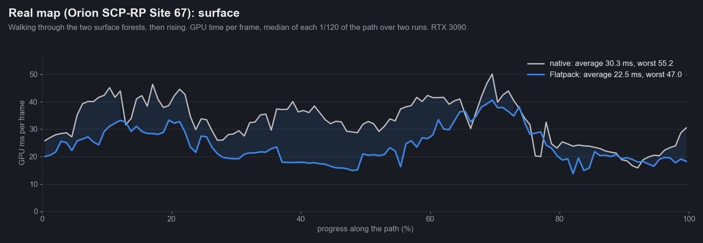

The camera flies a fixed path and every frame's GPU time is recorded, native against Flatpack (RTX 3090):

| Map | Native average | Flatpack average | Native worst | Flatpack worst |
|---|---|---|---|---|
| Showcase map (7,966 objects, licensed models) | 22.9 ms | **19.9 ms** | 57.6 ms | 55.0 ms |
| Real game map, surface forests | 30.3 ms | **22.5 ms** | 55.2 ms | **47.0 ms** |
| Real game map, indoors | 19.4 ms | **16.2 ms** | 34.3 ms | **25.7 ms** |

Gains are biggest where you can see far. In closed rooms the cost is lights and draw calls, and Flatpack changes
little. The real map is Orion SCP-RP's Site 67; details and the other charts in
[`Benchmarks/iteration-6-real-scenes`](Benchmarks/iteration-6-real-scenes/README.md).

## Graphics settings

Tie Flatpack to your game's graphics presets: high presets show real models everywhere, low ones lean on cards. One
line, from wherever your settings menu applies a preset:

```csharp
// Ultra / High: real models only. Medium: the default. Low: swap earlier. Lowest: swap as early as possible.
FlatpackSystem.Level = preset switch
{
	"Ultra" or "High" => FlatpackLevel.Off,
	"Medium" => FlatpackLevel.Balanced,
	"Low" => FlatpackLevel.Performance,
	_ => FlatpackLevel.Maximum,
};
```

Every Flatpack Renderer follows it within a few frames; nothing re-bakes. Measured on the 2,500-tree forest (534,024
triangles a tree, RTX 3090):

| Level | Swaps at | GPU | Triangles drawn |
|---|---|---|---|
| Off | never | 31.4 ms | 73.5 million |
| Balanced (default) | where the card looks right | 18.0 ms | 14.8 million |
| Performance | 0.6 times that, from 3 radii | 16.6 ms | 7.3 million |
| Maximum | 0.35 times that, from 1.5 radii | 15.7 ms | 11,700 |

Past Balanced the gains are small for this forest, because the near trees already cost little and the cards' own
drawing becomes the floor; scenes with heavy props close to the camera gain more. Lower levels show cards closer, where
they look softer than the model.

## Install

Flatpack is an s&box library (`anakin.flatpack`). In the editor, open **View > Library Manager**, find Flatpack and
install it. To work from source, clone this repo and copy `Libraries/Flatpack` into your project's `Libraries` folder.

## Give one model a Flatpack LOD

1. Select the object with the model in your scene.
2. Add the **Flatpack Renderer** component.
3. Press **Bake Impostor** in its inspector.

The bake takes a few seconds, checks itself against the model, and writes the atlases, a material and a `.fpack` resource next to
the model (or in `Assets/flatpack/` for models from sbox.game). The component swaps where the bake was measured to look like the
model (never closer than 6 bounding radii); bakes without a measurement swap at 30 bounding radii.

The inspector then shows the bake's quality level, how close it holds up, and where the card takes over.

Up close nothing changes: your `.vmdl`'s own LODs keep working, and the card is the last step after them. Every other
object using the same model finds the bake on its own once you add the component.

## Flatpack a whole scene in one click

**Editor > Flatpack > Optimize Scene** lists every model in the open scene with its copies, triangles and bake status,
and recommends each one with a reason: big savings, "cheap already", or skip for animated models. Recommended models
start ticked. Pick a quality level at the bottom, then **Flatpack Selected** bakes whatever is missing and adds Flatpack to every copy as one step, so Ctrl+Z
takes it all back; **Remove Flatpack from Scene** does the same in reverse.

Other ways in:

- Right-click a model in the asset browser: **Bake Flatpack Impostor**.
- Right-click an object in the scene view: bakes it and adds the Flatpack Renderer for you.
- **Editor > Flatpack > Impostor Baker** opens the bake window for a list of models. **Apply to Scene** then adds a
  Flatpack Renderer to every object in the open scene whose model has a bake, as one undo step.

## Flatpack Renderer

| Property | What it does |
|---|---|
| Impostor | The baked `.fpack`. Leave it empty to use any bake of the source model. |
| Source | The real model's renderer. Found on the same object if empty. |
| Auto Swap Distance | Pick the swap distance from the object's size and the bake's measurement. Off: use Swap Distance. |
| Swap When It Looks Right | On: swap at the distance the baker measured the card looking like the model, never closer than Minimum Swap Radii (6). Off, or no measurement: Auto Distance Factor (30) radii. |
| Swap Distance | Camera distance where the card takes over, in world units. |
| Hysteresis | Dead band around the swap distance, so a camera hovering at the boundary doesn't flicker. |
| Cross Fade, Fade Time | Dither the card in over the model instead of popping. |
| Levels | Optional extra models (lower-poly versions) to swap in by distance before the card. |
| Mode | Auto, or force the model or the card (handy for checking a bake). |

A Flatpack Renderer with no model renderer beside it shows the card at every distance.

`FlatpackSystem` checks every renderer's distance in one time-sliced pass per frame, so 5,000 trees cost one loop, and
all cards from the same bake share one model and material so the engine can instance them.

### Card as the last LOD of a .vmdl

If you'd rather use the engine's LOD switching (no hysteresis, no fade), add a LOD to the model in ModelDoc whose only
mesh is a quad with the impostor material and UVs from (0,0) top-left to (1,1) bottom-right. The shader ignores the
quad's position and size and builds the card from the bake data and the instance transform.

## Bake settings

| Setting | Default | Notes |
|---|---|---|
| Quality | Medium | Low, Medium, High, Ultra, Auto (see [Quality levels](#quality-levels)), or Custom for the three below. |
| Auto Target Radii | 30 | Auto only. The distance from which the card has to match the model: your swap distance. |
| Measure Quality | on | Check the finished bake against the model (about 2 seconds) and store where it looks right. |
| Grid Size | 12 | Custom only. Views per atlas side. 12 gives 144 views, 15 degrees apart. 8 ghosts. |
| Atlas Size | 2048 | Custom only. Grow it with the grid: each view gets Atlas Size / Grid Size pixels. |
| Search Steps | 16 | Custom only. Written into the material; the biggest lever on quality and GPU cost. |
| Layout | Hemisphere | Hemisphere for anything on the ground, Sphere for objects seen from below, Cylinder for classic tree billboards. |
| Z-Locked Card | off | Card only turns around the object's up axis. Always on for Cylinder. |
| Bake Roughness Ao | on | Roughness and material AO atlas. |
| Bake Self Shadow | off | Bakes how much sky each part sees; see Sky Occlusion below. Triples bake time. |
| Supersample | 2 | Render each view this much larger and average down. 2 keeps thin parts as partial coverage; 4 adds little. |
| Edge Padding | 16 | Texels of colour grown past each silhouette, so mipmaps don't halo. |
| Fit Each View | on | Frame every view to the model's own outline and depth instead of its bounding sphere: more texels and finer depth on the object. Fine wire mesh bakes unframed regardless. |
| Depth Bits | 8 | 8 (BC4) or 16 (R16, about 8 MB more at Medium): 16 had 2 points fewer wrong pixels up close. |
| Output Folder | next to the model | Relative to `Assets`. |

The impostor material (`<name>_fp.vmat`) has a few dials of its own: **Search Steps** (depth trace quality, set by the
quality level), **Thickness**, **Blend Sharpness**, **Alpha Clip**, **Edge Floor** (how much of Alpha Clip an edge pixel
needs before it's drawn; stops stray specks), **Metalness** (added to the baked metalness),
**Shadow Bias**, **Coarse Stride** (texels between samples where the search can hit something; 1 is slower and
finds the thinnest parts), **Agreement** (fades out views whose surface lies behind the nearest one; off by
default, measured in iteration 8), **Sky Occlusion**
(darkens enclosed parts using the self-shadow bake, for dense foliage) and, for see-through bakes, **Soft Coverage** and
**Soft Growth** (the baker fits both to the model). The baker also writes per-mip alpha corrections it measured from the atlas, so
thin parts keep their coverage as the card shrinks.

## How it works

**Bake.** Flatpack opens a private scene with nothing in it but your model and an orthographic camera, and renders it
from each grid direction through s&box's debug views: albedo, world normals, roughness and AO come out as raw material
data with no lighting or tonemapping. A small helper shader writes linear depth at 16 bits. Each view's camera is fitted
to the model's outline and depth in that view, so the model fills the frame. The frames go into albedo, normal, depth and
material atlases, plus a small map of the nearest surface in every 16 x 16 texel block, and the baker grows colour into
the empty space around each silhouette so filtering can't pull in the background.

**Draw.** The vertex shader turns the quad toward the camera, on the front face of the model's bounding sphere. The
pixel shader picks the three baked views nearest your view direction, with barycentric weights. For each one it traces
the pixel's view ray through that view's depth map until it hits the baked surface, so all three land on the same
point of the model and agree. The block map lets the trace skip empty space in one step and sample closely only where it
can hit something, so thin parts aren't stepped over. It blends them, rotates the baked normals by the object's rotation, writes the real
surface depth, and shades the result with the standard s&box lighting, shadows and fog. The shader promises the GPU
that this depth is never nearer than the card itself, so pixels hidden behind other cards are thrown away before the
trace runs (6 to 29% less GPU time in a dense forest).

## Limits

- Up close the card is only as sharp as one frame: about 170 pixels across at Medium, now with the model filling it.
  Flat surfaces seen at a grazing angle (the far edge of the dragon's plinth at 2 radii) still show some broken texels.
- In a dense crowd seen from inside, cards can cost more GPU time than simple models (a 912-triangle chair: 1.9 ms as
  models, 7.3 ms as cards). Cards pay off at a distance; that's what the swap distance is for.
- Hemisphere bakes can't show an object from below. Use Sphere for those.
- Foliage shaders with translucency or wind lose those effects on the card. The card uses standard lighting. Baking
  self shadow on by default and leaning leaf normals outward were tried in iteration 8 and made both test trees worse.
- Very thin parts (twigs, spindles) thinner than one texel can't survive the bake. Wire mesh works from about 6 radii
  at Ultra (the baker spots it and fits the card to the model), but past 24 radii it speckles where the real fence
  shows a tidy grid. A light fence is also cheaper to draw as itself: 2,500 fences took 14.0 ms as models and 15.0 to
  17.4 ms as cards.
- Below about 2 bounding radii the card stops matching the model. Swap well before that (the default is 30).

## This repository

The repo root is **Flatpack Testbed**, an s&box project that hosts the library during development. It is never
published.

- `Libraries/Flatpack/`: the library (`Code`, `Editor`, `Assets/shaders`, unit tests).
- `Assets/scenes/flatpack_test.scene`: a real chair beside a Flatpack chair.
- `Assets/scenes/flatpack_suite.scene`: five high-poly props from sbox.game beside their cards. Re-bake them from the
  Flatpack Renderer inspector after cloning; their bakes aren't in git.
- `Assets/scenes/flatpack_benchmark.scene`: the grid used for the numbers above.
- `CHANGELOG.md`: every change, with how it was tested.
- `docs/ROADMAP.md`: what's next, from the research behind each item.

## Credits

Flatpack by [Anakin Studio](https://github.com/Anakin-Studio), MIT licence.

Tree_small_01 in the images by Small Box Studio
([sbox.game/smallboxstudio/treesmall01](https://sbox.game/smallboxstudio/treesmall01)), CC BY 4.0. The ten comparison
models and their creators are listed in [iteration 3](Benchmarks/iteration-3-ten-models/README.md#models).
